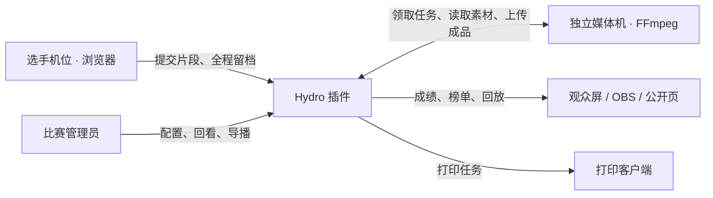
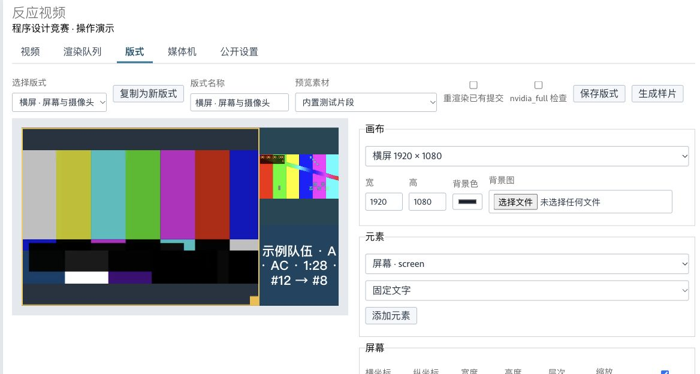

# Hydro Contest Better

[](https://github.com/Albert-Li-Sz/Hydro-Contest-Better/releases/latest)
[](LICENSE)

[在线操作手册](https://albert-li-sz.github.io/Hydro-Contest-Better/) · [反应视频媒体机教程](https://albert-li-sz.github.io/Hydro-Contest-Better/media-worker.html) · [版本下载](https://github.com/Albert-Li-Sz/Hydro-Contest-Better/releases) · [验证记录](docs/verification.md)

Hydro Contest Better 是 Hydro OJ 的 ACM 办赛插件。从热身赛签到、正赛判题与气球配送，到封榜、滚榜与获奖名单导出，工作人员都可以在比赛页面操作。增强榜、大屏和直播共用本场的排名、奖项与封榜设置。

## 目录

- [版本与运行环境](#版本与运行环境)
- [系统组成](#系统组成)
- [快速开始](#快速开始)
  - [安装 Hydro 插件](#安装-hydro-插件)
  - [运行反应视频媒体机](#运行反应视频媒体机)
- [使用示例](#使用示例)
  - [配置一次比赛并投屏](#配置一次比赛并投屏)
  - [从判题生成反应视频](#从判题生成反应视频)
  - [滚榜并导出成绩](#滚榜并导出成绩)
- [功能](#功能)
- [升级与卸载](#升级与卸载)
- [开发与验证](#开发与验证)
- [上游项目与许可](#上游项目与许可)

## 版本与运行环境

| 组件 | 安装位置 | 环境与版本 |
| --- | --- | --- |
| Hydro 插件 | 运行 Hydro 主服务的环境 | v1.21.0。Node.js 22+、Hydro 5.x。已有 Hydro 5.0.7 和 5.1.0 的验证记录 |
| 反应视频媒体机 | 能访问比赛网址、有临时磁盘空间的电脑或服务器 | 与插件对应的 `1.21.0` Docker 镜像。默认使用 CPU，可按需配置硬件编码 |
| 打印客户端 | 与现场打印机相连的电脑 | 发布页提供 Windows、Linux、macOS 的 amd64 与 arm64 程序 |

需要制作反应视频时再启动媒体机，需要比赛打印时再连接打印客户端。升级已有比赛后，提交片段、全程留档和反应视频公开均默认关闭。

## 系统组成



Hydro 使用 MongoDB 保存配置、比赛状态和任务，使用本地目录或 S3 兼容存储保存录像。FFmpeg 在媒体机内运行。媒体机主动连接 Hydro 的比赛接口，每台机位只需在浏览器中按比赛安排授权屏幕或摄像头。

## 快速开始

### 安装 Hydro 插件

在运行 Hydro 的系统用户下操作。有多套 Hydro profile 时，先将 `HYDRO_PROFILE` 设为比赛实例使用的值。下面的 Linux 命令下载完整安装包、校验 SHA-256 并解压。

```bash
release=https://github.com/Albert-Li-Sz/Hydro-Contest-Better/releases/download/v1.21.0
package=hydro-scoreboard-xcpcio-plus-1.21.0.tgz
mkdir -p hydro-contest-1.21.0 && cd hydro-contest-1.21.0
curl -fLO "$release/$package"
curl -fLO "$release/$package.sha256"
sha256sum -c "$package.sha256" && tar -xzf "$package"
```

首次安装运行以下命令。已有安装使用下方的[升级步骤](#升级与卸载)。

```bash
bash package/install.sh install
```

默认安装路径为 `$HOME/.hydro/addons/hydro-scoreboard-xcpcio-plus`。脚本注册 addon 后执行 `pm2 restart hydrooj`。服务重启后，用比赛所有者或具备「编辑比赛」权限的账号打开一场 ACM 比赛，右侧菜单会出现「赛事中控」「榜单与奖项」「滚榜」等入口。[其他安装方式与参数](docs/usage.md#安装)

### 运行反应视频媒体机

在 Hydro 比赛页面打开 **反应视频 → 媒体机**。首次使用点击 **生成令牌**，已有令牌时直接点击 **复制接口地址**。该地址是本场比赛的访问凭证。

在媒体机的终端运行下面一行，然后粘贴刚复制的完整地址并按回车。示例适用于 Linux 或 macOS 的 Bash。

```bash
read -r -s -p '粘贴本场媒体机接口地址并按回车：' HYDRO_REACTIONS_API
```

在同一个终端拉取镜像并启动后台服务。Docker 会挂载当前目录下的 `out` 保存编码输出。

```bash
image=ghcr.io/albert-li-sz/reactions-generator-hydro:1.21.0
mkdir -p out
docker pull "$image"
docker run -d --name hydro-reactions --restart unless-stopped \
  -v "$PWD/out:/app/out" \
  "$image" all "$HYDRO_REACTIONS_API" --hydro-upload
unset HYDRO_REACTIONS_API
```

回到 **反应视频 → 媒体机 → 媒体机心跳** 点击 **刷新**。页面显示机器名和「在线」即表示连接成功，心跳每 15 秒更新一次。排查连接时可运行 `docker logs --tail 100 hydro-reactions`。[媒体机安装与出片教程](https://albert-li-sz.github.io/Hydro-Contest-Better/media-worker.html)

## 使用示例

### 配置一次比赛并投屏

1. 进入比赛的 **赛事中控**，选择 Hydro、ICPC 区域赛或 CCPC 赛制。在 **榜单与奖项** 配置分榜、奖牌、奖杯、特别奖和学校显示规则。默认只有主榜。
2. 在 **大屏** 选择画面与分榜，预览后复制该画面的链接，在场馆电脑打开并按 `F` 全屏。切换到 **直播** 可复制直播画面链接，将它添加到 OBS 的浏览器源，设置为 1920×1080。
3. 在导播台选择榜单、评测队列、队伍画面或字幕。观众屏与 OBS 链接可免登录播放，导播台使用有比赛管理权限的账号。[现场大屏](docs/usage.md#大屏) · [导播和 OBS](docs/usage.md#直播)

### 从判题生成反应视频

1. 在 **画面采集** 启用设备，绑定测试队伍，在 **录制设置** 开启「提交片段」。选手在采集窗口选择屏幕或摄像头并开始采集。赛前可以先发起 30 秒自检，检查试录、掉帧和上传情况。
2. 让测试队伍在比赛中提交一道题。判题结束后，在 **画面采集 → 录像** 查看对应提交的片段状态。片段就绪且匹配启用的版式后，在线媒体机会领取任务并回传 MP4。
3. 在 **反应视频** 预览成品，检查画面、声音及学校信息，再配置公开范围和时机。导播可回放原始片段与成品，大屏可选择「反应视频轮播」。封榜、版式和撤下操作会影响观众可以播放的内容。[录制、留档与公开规则](docs/usage.md#录制与反应视频)

[](https://albert-li-sz.github.io/Hydro-Contest-Better/media-worker.html)

### 滚榜并导出成绩

1. 打开 **滚榜**，选择主榜或分榜并新建会话。比赛结束前创建的会话会标记为彩排。主持端可投到观众屏，逐步揭晓封榜后的判题。观众刷新后可恢复当前进度。
2. 需要放出正式成绩时，在 **赛事中控** 或榜单页解除封榜。赛后可在 **成绩与导出** 保存快照、比较重测前后的变化，导出成绩与获奖名单 CSV。[滚榜操作](docs/usage.md#resolver-滚榜) · [成绩与导出](docs/usage.md#成绩与导出)

## 功能

| 场景 | 可用功能 | 操作说明 |
| --- | --- | --- |
| 榜单与奖项 | 学校、参赛类型及手动分榜。同分规则、学校名次、奖牌、奖杯、特别奖、打星队一血资格。Hydro 5.1 队名与队员显示 | [规则](docs/usage.md#规则) |
| 滚榜与大屏 | 每位管理员可独立创建滚榜会话，进度保存在 MongoDB。24 种大屏画面，含榜单、排名趋势、首解、队伍与学校、气球、海报、公告与反应视频 | [滚榜](docs/usage.md#resolver-滚榜) · [大屏](docs/usage.md#大屏) |
| 直播与录像 | OBS 画面、双语导播台、赛况统计、自动解说、首解和奖牌线。机位采集、提交片段、全程留档、压力测试、回看和按范围清理 | [直播](docs/usage.md#直播) · [录像](docs/usage.md#录制与反应视频) |
| 赛中服务 | 答疑按题分派和认领，比赛公告进入大屏和直播。气球按考场和题目配送，支持免登录志愿者链接和热敏小票 | [答疑台](docs/usage.md#答疑台) · [气球配送](docs/usage.md#气球配送) |
| 现场监控 | 签到、IP 与座位核对、离线与采集中断告警。评测机在线状态、并发、速度和系统错误。供来宾视察的全屏赛况总览 | [机位](docs/usage.md#机位监控) · [评测](docs/usage.md#评测监控) · [总览](docs/usage.md#赛况总览) |
| 系统管理 | 用户与队伍资料、座位与 IP、免登录链接轮换。评测账号、并发与重测分流。分区分场打印、打印机负载均衡及批量重测 | [系统管理](docs/usage.md#系统管理) |
| 成绩与对接 | 分榜成绩与获奖名单 CSV、成绩快照、重测复核。ICPC CCS Contest API 2026-01 支持角色权限、持久化事件流和 webhook，每场独立开启 | [成绩与导出](docs/usage.md#成绩与导出) · [CCS API](docs/usage.md#ccs-api2026-01) |

## 升级与卸载

**升级**时先下载、校验并解压目标版本，在新安装包的解压目录运行以下命令。

```bash
bash package/install.sh upgrade
```

脚本备份受影响的旧目录并处理原有 addon 注册。使用自定义目录时传入 `--dir /绝对路径`，PM2 进程名称不同则传入 `--service 进程名`。容器部署将 addon 安装到持久化目录，使用 `--no-restart`，再由原服务管理器重启 Hydro。

**卸载**时运行已安装插件中的脚本。下例采用默认路径。

```bash
bash "$HOME/.hydro/addons/hydro-scoreboard-xcpcio-plus/install.sh" uninstall
```

升级备份和卸载归档位于安装目录旁的 `.hydro-addon-backups/hydro-scoreboard-xcpcio-plus/`。卸载后 MongoDB 中的比赛设置、滚榜会话和直播配置保留。[卸载与恢复](docs/usage.md#卸载与恢复)

## 开发与验证

发布验证环境使用 Node.js 24、pnpm 11 和 Hydro 5.1.0。构建打印客户端需要 Go 1.22 或以上。

```bash
pnpm install --frozen-lockfile
pnpm typecheck
pnpm test
pnpm test:ui
pnpm preview
```

`pnpm preview` 在 `http://127.0.0.1:18900/` 启动演示比赛。可直接进入 `/contest/demo/resolver`、`/contest/demo/screens` 和 `/contest/demo/live`。`pnpm test:ui` 使用系统 Chrome 检查手机和桌面宽度、明暗主题和主要操作，必要时用 `CHROME_PATH` 指定浏览器。

服务端代码位于 `index.ts` 和 `lib/`，界面位于 `client/`、`frontend/` 和 `templates/`。XCPCIO 0.98.0 的榜单补丁由 `scripts/assets.mjs` 应用。校徽、字体和图标随包分发。更新校徽使用 `pnpm logos`，需要本机安装 `cwebp`。`pnpm build:live` 从固定上游提交重建 Live 前端，`pnpm build:print-client` 生成打印客户端，`pnpm pack --pack-destination ./dist` 生成插件安装包。[验证记录](docs/verification.md)

## 上游项目与许可

插件及 Hydro 适配代码使用 AGPL-3.0-or-later。XCPCIO、Resolver-Web、ICPC Live 以及媒体机采用的 ICPC reactions-generator 各自保留上游许可。Resolver-Web 所含 ICPC Tools 移植内容适用 ICPC Software License，涉及非商业使用、公开源码和保留许可证，商业或创收用途须取得书面例外授权。[插件许可](LICENSE) · [第三方声明](NOTICE) · [许可证目录](licenses/) · [Resolver 来源](resolver/CHANGES.md) · [Live 来源](live/UPSTREAM.json) · [媒体机来源](media-worker/README.md)
