# Hydro XCPCIO 增强榜

基于 `@hydrooj/scoreboard-xcpcio` 的独立增强插件，使用 XCPCIO 0.98.0 前端，适用于 Hydro ACM 比赛。可与原插件同时安装，通过单独的 `xcpcio-plus` 视图使用。

- 使用 Hydro 原生分区、表单、按钮和深色主题，适配桌面、平板和手机。
- 榜单显示金、银、铜牌标记，开启一血奖后用深绿色高亮符合资格的最早通过。
- 不显示选手头像；选手名在上、学校在下合并为一列，打星选手在学校后显示 ★；每行先显示学校 Logo（桌面上与行同高），随后是选手和学校，未填写学校显示 ICPC 标志。Logo 随插件打包，运行时不访问外部站点。
- 选手名对所有观众显示 Hydro 域内的“显示名”（未设置时显示用户名）。
- 提交列表中的结果按通过、未通过、待评测着色。
- 比赛进行中，只有比赛所有者和有管理或隐藏榜权限的用户能看到“提交”页；比赛结束后对所有人开放。
- 默认仅主榜。学校榜与参赛类型榜需管理员明确启用，手动榜需逐个创建。已明确保存的分榜设置继续生效。
- 每场比赛可创建手动榜，从参赛名单勾选成员；同一选手可加入多个榜。
- 支持多学校、参赛资格、用户组及公开资料字段的组合筛选，可批量勾选、取消或替换为筛选结果，并可撤销上一次批量操作。
- **每个分榜独立排名、计算奖牌和组内一血**，符合本项目采用的比赛规则。
- 每个榜单均可独立设置金银铜名额（固定数量或按有效队伍比例）与名称、并列同奖、一血奖、奖杯和打星选手的一血资格；奖牌和奖杯可按队伍名次或学校名次颁发。同分规则可选 Hydro、ICPC 区域赛或 CCPC 规则，并支持 CCPC 新榜单模式（封榜前隐藏题号）。榜单、滚榜、大屏、直播、CCS API 与成绩导出共用设置，入口为比赛右侧菜单的“榜单与奖项”，比赛当天的常用设置集中在“赛事中控”。
- 打星选手保留成绩与星号，金银铜及奖杯仅授予正式选手。一血与特别奖的资格按各自规则设置。
- 设置按域和比赛保存在 Hydro MongoDB 中，重启后保留。
- 支持替换原生榜单，并提供无需登录、域权限或比赛权限的公开链接；公开数据继续遵守封榜规则和开赛前不显示榜单的规则。
- 学校属于 Hydro 私有资料，默认只对有“查看用户私有信息”权限的用户显示；每场比赛可选择向所有观众显示。

## CCS API（2026-01）

1.0.0 起在插件内提供 [ICPC CCS Contest API 2026-01](https://ccs-specs.icpc.io/2026-01/contest_api)，不依赖 `hydro-dev/ccs-api`。两者的地址不同，可以同时安装。API 的排名、罚时、封榜及奖项复用增强榜和直播模块的规则。

在 ACM 比赛的“榜单与奖项设置”中勾选“开放 CCS API”并保存；默认关闭。根地址为 `/d/<域ID>/ccsapi/`，比赛地址为 `/d/<域ID>/ccsapi/contests/<Hydro比赛ID>`。设置页显示并可复制当前比赛地址。`contests` 只列出调用者可访问且已开启 API 的 ACM 比赛。

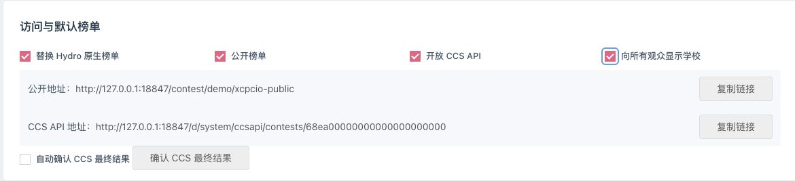

### 认证与可见性

支持 Hydro 用户名和密码的 HTTP Basic 认证，也接受浏览器已登录的 Hydro 会话。实际连接请使用站点 HTTPS 地址。启用双因素认证的账号不能仅凭 Basic 密码登录，需使用 Hydro 会话或专用的普通账号。停用账号、密码变化、角色变化和关闭 API 会使后续请求或持续事件连接失效。

| 角色 | 对应用户 | 数据与操作 |
| --- | --- | --- |
| public | 匿名或非参赛普通用户；比赛须开启“公开榜单” | 开赛前隐藏题目、队伍与提交；封榜后不显示隐藏判题结果；比赛中错误结果按简化类型输出；只读 |
| team | 已参加比赛的个人或组队成员 | 公开数据、本队完整判题与测试点、本队代码和发给本队的澄清；可提交及提问 |
| judge | 有查看隐藏榜单权限的用户 | 全部实时数据、代码与账号；可发送裁判澄清及解说 |
| admin | 比赛所有者或有编辑比赛权限的用户 | 全部数据、比赛时钟和解冻、代理与历史提交、代理与历史澄清、奖项管理、最终确认 |

学校、校徽及学校分组遵守“向所有观众显示学校”。`access` 返回当前角色的端点、字段和能力。账号不返回密码；其他队伍及匿名访问不返回代码下载链接。所有 API 响应带 CORS 头，JSON 错误为 `{"code":400,"message":"…"}`；会话写请求拒绝跨站来源。

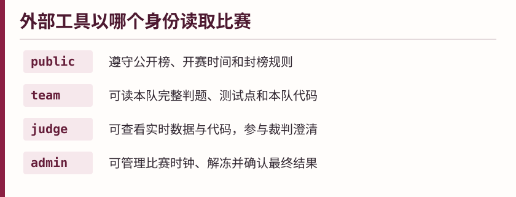

### 端点

下表中比赛端点均位于 `contests/<比赛ID>/` 下。列表端点也支持 `/<对象ID>` 获取单个对象，支持按其标量 ID 引用字段过滤，例如 `judgements?submission_id=…`、`submissions?team_id=1`；空过滤值匹配空引用。

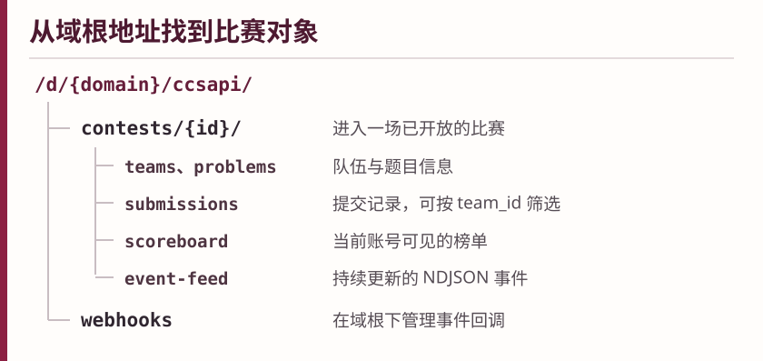

| 端点 | 内容 |
| --- | --- |
| 根地址 `/`、`contests`、`contests/<ID>` | 版本 2026-01、插件名称和版本，以及比赛信息 |
| `access`、`account` | 当前角色的能力、可见字段与当前账号 |
| `judgement-types`、`languages`、`problems` | 判题类型、语言、题号与颜色、限制、测试点数和附加文件 |
| `groups`、`organizations`、`teams`、`persons`、`accounts` | 正式/非正式、学校与手动分榜，学校及 PNG 校徽、队伍、队员、管理人员与账号 |
| `state` | started、frozen、ended、thawed、finalized、end_of_updates |
| `submissions`、`judgements`、`runs` | 提交、每次评测（含重测历史）、测试点结果和运行时间 |
| `clarifications`、`awards`、`commentary` | 原生问题与回复、定向/分组澄清、自动或手动奖项、中文自动解说及人工解说 |
| `scoreboard` | 正式参赛主榜；`?group_id=…` 请求独立排名的分组榜 |
| `event-feed` | 持久化 NDJSON 事件流及断点续传 |
| 根地址下的 `webhooks`、`webhooks/<ID>` | 域内比赛管理员注册、查看、删除回调；不返回回调 token |

个人队伍 ID 为 uid，负 uid 的虚拟队伍使用 `t<绝对值>`，例如 `t1001`；队伍 label 使用此编号。题目 ID 为 Hydro 数字 docId，提交默认使用评测记录 ID。语言、分组和派生对象 ID 保持稳定，必要时规范化并加哈希，满足规范长度与字符规则。

### 读取与事件流

```bash
CCS_BASE='https://oj.example/d/system/ccsapi'
CCS_CONTEST='替换为24位比赛ID'
# curl -u 只填写用户名时，会提示输入密码。
curl -u service "$CCS_BASE/contests/$CCS_CONTEST/access"
curl -u service "$CCS_BASE/contests/$CCS_CONTEST/scoreboard?group_id=official"
curl -N -u service "$CCS_BASE/contests/$CCS_CONTEST/event-feed"
# 保存最后收到的完整 token，重连时原样传回；不是单纯的整数序号。
curl -N -u service "$CCS_BASE/contests/$CCS_CONTEST/event-feed?since_token=替换为最后的token"
```

每条事件含 `type`、`id`、`data`、`token`；删除事件的 data 为 null。无 token 时重放此角色视图的持久日志，随后持续推送；每 60 秒空行保活。不同比赛、队伍、权限或学校可见性视图的 token 不能混用，非法或超前 token 返回 400。事件没有 TTL，不因服务重启过期。初次启动后由写入器生成视图，通常数秒内出现事件。

MongoDB 租约让一个进程负责生成事件，其他进程读同一日志；事件批次先持久化再公开，重启可恢复未完成批次。比赛中兜底读取约每 2 秒一次，赛前较远或非活跃比赛约每 30 秒一次，评测与配置变化会提前触发。恢复时可能重复通知相同对象，消费者应按对象 ID 应用更新。

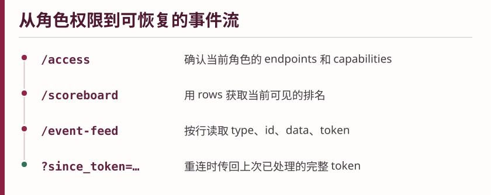

webhook 只发送注册后的变更。使用 `POST $CCS_BASE/webhooks`，JSON 例如 `{"url":"https://receiver.example/ccs","token":"client-generated-secret","endpoints":["teams","judgements"],"contest_ids":[]}`。空数组表示全部事件类型/本域可管理且已开放的比赛。回调头为 `Webhook-Token`，请求体为 `{"contest_id":"…","notifications":[…]}`。同一接收方顺序发送，2xx 后推进游标，失败重试，连续失败 30 分钟停用；所有者失去管理权限后也停用。回调工作不会阻塞事件生成。接收方应处理崩溃恢复导致的重复投递。

### 写入与最终结果

- `PATCH contests/<ID>`：管理员修改开始时间、暂停/恢复倒计时、安排解冻。必须带 `id`。距开赛 30 秒内或已经开赛时不允许修改开始时间；暂停用 `start_time: null` 和可选的 `countdown_pause_time`。解冻用 `scoreboard_thaw_time`，不能早于比赛结束。
- `POST submissions`：team 提交本队代码；admin 不带 time 时代理提交（必须带 team_id），带 time 时导入历史提交。`PUT submissions/<ID>` 必须有匹配的 id、time 和 team_id。files 是恰好一个含单个 UTF-8 源文件的 ZIP，以 base64 放入 data，mime 可省略或为 `application/zip`；遵守 Hydro 的代码长度、语言范围、参赛资格与比赛时间限制。入口由 Hydro 语言配置确定，entry_point 须省略或为 null。ZIP 校验拒绝路径越界、重复文件名、加密、损坏数据及超限解压。
- `POST/PUT clarifications`：team 提问、judge 裁判回复/公告、admin 代理提问及历史导入。使用 `to_team_ids` / `to_group_ids`，可指定多队或分组；PUT 必须带 id 和 time。私有问题不会因向其他队共享回复而泄露。CCS 定向消息持久化在独立集合，可表达的普通问题与回复同时尝试镜像到 Hydro；多队/分组消息通过 CCS 查看。镜像失败不撤销已存储的 CCS 消息，并记录服务端日志。
- `POST commentary`：judge/admin 提交 message、tags 及可选队伍/题目/提交引用；服务端设置作者与时间。
- `POST/PUT/PATCH/DELETE awards`：admin 管理奖项。修改后该 ID 由管理员接管，不被自动计算覆盖。`team_ids: null` 表示暂停更新，空数组表示当前无人获奖。自动奖项包括冠军、金银铜、已开启的一血和分组冠军。一血奖要等更早的合资格待评测提交全部判完，避免提前公布后换队。
- 设置页“确认 CCS 最终结果”（扩展 `POST contests/<ID>/finalize`）要求已结束、已解冻且无待评测提交。默认手动确认；可开启自动确认，在条件满足且数据稳定 30 秒后触发。确认后保存不可变 CCS 数据快照，拒绝后续 CCS 写入，`end_of_updates` 是事件流最后一条事件。之后 Hydro 中的重测、改题或修改奖项不改变该快照；关闭 API 和收紧学校可见性仍立即生效。需要修改最终结果时，应在确认前完成。

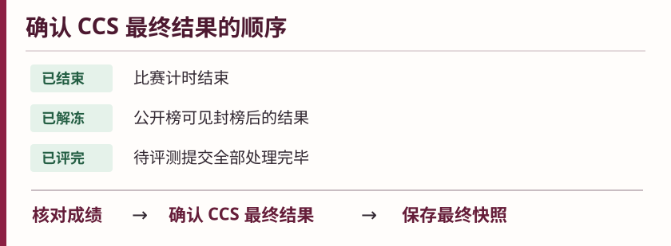

### 数据边界与验证范围

没有伪造 Hydro 未记录的数据：历史评测的开始时间仅在监控或写入器实际观察到时提供；测试点没有绝对完成时间，因此 runs 不提供 time/contest_time。没有原生 PDF 题面、Kattis 题目包、输出大小配置、ICPC CMS 编号、场地坐标、座位号、教练登记、队伍媒体流与反应视频等来源时，不输出这些字段。邮件、性别、账号密码等未作为本插件比赛公开资料提供。旧 `team.hidden`、单个 `to_team_id`、整数 penalty_time、XML Event Feed 和旧 JSON Scoreboard 不实现。

Schema 测试固定使用官方 2026-01 分支文件；上游 schema 对 runs 时间和 submission files 的无条件 required 与可见性/缺失数据有差异，本地测试仅放宽这些要求，原始 schema 文件不改。历史 judgement 开始时间缺失也属于上述数据例外。因此不能把测试结果解释为所有响应均通过未调整的官方校验器。

本地预览：`pnpm preview` 后在演示设置页开启 API，根地址为 `http://127.0.0.1:18900/d/system/ccsapi/`（设置 `XCPCIO_PREVIEW_PORT` 可改端口），演示比赛 ID 为 `68ea00000000000000000000`；账号 `admin`、`judge`、`team1` 等的演示密码均为 `preview`。预览使用内存模拟 Hydro，提交只进入模拟待评测状态，不连接真实评测机。生产插件使用 Hydro 模型和 MongoDB，不使用演示账号或内存数据库。具体测试结果与部署验证边界见 [验证记录](verification.md)。

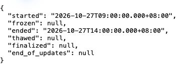

## 安装

需要 Node.js 22 或以上版本及 Hydro 5.x。使用运行 Hydro 的系统用户操作；命令中的 `$HOME` 对应这个用户。自 0.8.1 起，安装包包含供 Hydro 直接加载的源码和完整预构建资源。

下载 `hydro-scoreboard-xcpcio-plus-1.21.0.tgz` 并放入当前目录。首次安装按以下步骤解压、注册 addon 并重启服务。

```bash
mkdir -p "$HOME/.hydro/addons/hydro-scoreboard-xcpcio-plus"
tar -xzf hydro-scoreboard-xcpcio-plus-1.21.0.tgz \
  -C "$HOME/.hydro/addons/hydro-scoreboard-xcpcio-plus" --strip-components=1
hydrooj addon add "$HOME/.hydro/addons/hydro-scoreboard-xcpcio-plus"
pm2 restart hydrooj
```

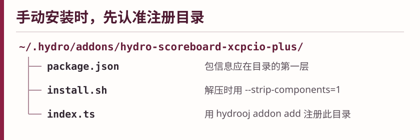

### 脚本安装与升级

在新的临时目录中解压安装包，然后运行包内脚本。升级时运行新安装包中的脚本。

```bash
mkdir -p xcpcio-update
tar -xzf hydro-scoreboard-xcpcio-plus-1.21.0.tgz -C xcpcio-update
bash xcpcio-update/package/install.sh install
# 已有安装时
bash xcpcio-update/package/install.sh upgrade
```

脚本先检查完整资源并准备新目录，再备份旧目录和 addon 列表、注册新路径，最后重启 Hydro。旧版通过 `yarn global add` 安装时，脚本会将包名注册迁移到目录注册；也会解除同名插件旧目录的注册。原来由包管理器安装的文件仍由该包管理器管理。

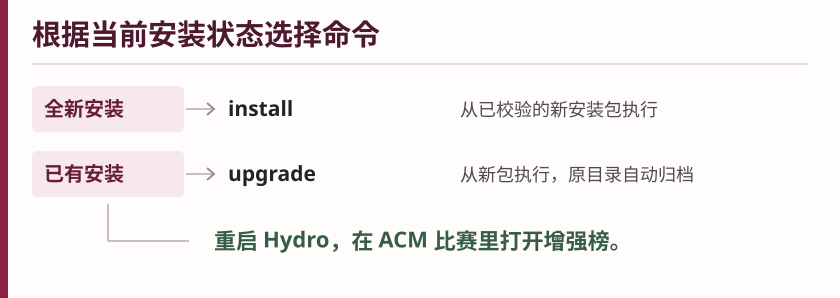

| 参数 | 用途 |
| --- | --- |
| `--dir /绝对路径` | 设置安装目录，默认当前 Hydro 配置目录下的 `addons/hydro-scoreboard-xcpcio-plus` |
| `--service hydrooj` | 设置要重启的 PM2 进程名 |
| `--no-restart` | 由容器或其他服务管理器执行重启 |
| `--help` | 查看脚本用法 |

指定自定义安装目录后，升级和卸载时继续传入相同的 `--dir`。Hydro profile 使用对应的 `HYDRO_PROFILE`，并通过 `--service` 指定该 profile 的 PM2 进程。容器内使用持久化目录和 `--no-restart`，操作完成后重启 Hydro 主服务。

### 卸载与恢复

```bash
bash "$HOME/.hydro/addons/hydro-scoreboard-xcpcio-plus/install.sh" uninstall
```

卸载会解除本插件的 addon 注册，将安装目录和发布的静态资源移入备份，然后重启 Hydro。MongoDB 中的比赛设置、滚榜会话、直播配置和媒体保留，再次安装后可继续使用。旧版尚无脚本时，可以下载新包并运行其中的 `install.sh uninstall`。

备份位于安装目录旁的 `.hydro-addon-backups/hydro-scoreboard-xcpcio-plus/<时间戳>/`。`addon.json` 记录操作前的注册列表，`operation.json` 记录安装目录和服务名，`plugin/` 保存操作前的目录安装。正常执行期间若注册或重启命令失败，脚本会恢复旧目录和注册，并尝试重新启动原服务。发生进程被强制终止等异常时，可依据这些备份恢复原注册和插件目录，再重启服务。

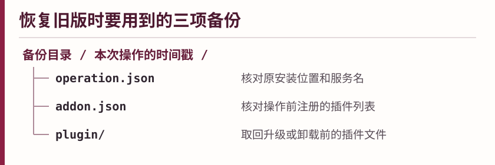

在源码目录执行 `pnpm install --frozen-lockfile` 和 `pnpm pack --pack-destination ./dist` 可生成同样的完整安装包。`prepack` 会生成所需静态资源。

## 使用

无需登录的公开榜单地址（未保存过设置的比赛默认不公开，可在每场比赛设置中开启，或在插件配置中设 `publicByDefault: true` 改为默认公开）：

```text
/d/<域ID>/contest/<比赛ID>/xcpcio-public
```

默认替换开启后，原生 `/contest/<比赛ID>/scoreboard` 链接会在原生权限检查前跳转到此公开入口。也支持带 `/d/<域ID>` 的链接和域名绑定的子域。旧的增强榜链接同样会跳转到公开入口：

```text
/d/<域ID>/contest/<比赛ID>/scoreboard/xcpcio-plus
```

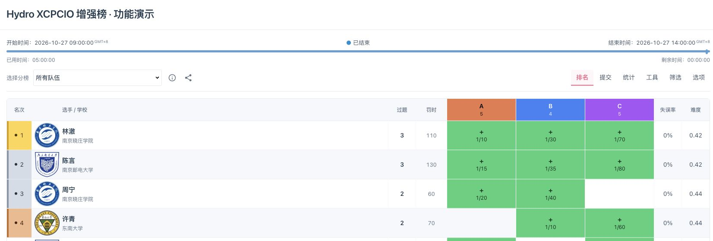

比赛日常用的设置集中在“赛事中控”（见下一节）。完整的奖项与分榜设置在比赛右侧菜单的“榜单与奖项”：比赛所有者或有编辑比赛权限的管理员从这里进入（榜单页的“榜单与奖项设置”、滚榜配置页的“修改榜单与奖项设置”也指向这里）。榜单、滚榜、大屏、直播和 CCS API 都使用这里的奖项与排名规则，无需分别配置。设置页也可直接访问：

```text
/d/<域ID>/contest/<比赛ID>/xcpcio-settings
```

1. 在“奖项与排名规则”选择同分规则（Hydro、ICPC 区域赛或 CCPC）和奖牌名额方式（固定数量或按有效队伍比例），设置默认金、银、铜牌名额，以及“允许打星选手获一血奖”（默认关闭）。
2. 设置是否替换原生榜单、是否公开访问、是否向所有观众显示学校，开启需要的学校榜和正式资格榜。
3. 点击“添加手动分榜”，填写名称。已有分榜先展开“选择成员”，再添加筛选条件，选择一个或多个学校，叠加正式资格、用户组或其他字段条件，再点击“勾选筛选结果”，或点击“替换为筛选结果”让成员名单恰好等于筛选结果。也可搜索、逐个勾选或批量取消成员。
4. 如需某个榜单单独的奖项，在“各榜奖项”中展开该榜并勾选“单独设置此榜奖项”。
5. 保存后返回榜单，所有观众都可切换这些榜；切换地址可直接分享。

学校等取值支持直接连续勾选和搜索，手机无需使用 Ctrl / Command 多选。条件之间支持“满足全部”或“满足任一”，同一条件内的多个取值满足其中一个即可。筛选还支持排除、包含关键词、未填写及已填写。批量操作保存当前选中的成员，可随时重新筛选调整。

插件配置中的 `publicByDefault` 默认为 `false`，只影响尚未保存过设置的比赛；已保存的比赛以各自的“公开榜单”开关为准，旧设置中缺少该字段时按关闭处理。

“向所有观众显示学校”默认关闭，旧设置缺少该字段时同样按关闭处理：此时无“查看用户私有信息”权限的观众（包括匿名访客）看不到学校列和学校榜；有该权限的登录用户在非公开视图中仍能看到。选手名不受此设置影响，始终显示显示名。`asDefault` 默认为 `true`，控制全局默认榜单替换；每场比赛还可单独关闭替换。若旧配置显式设置了 `asDefault: false`，升级后需改为 `true`。关闭公开访问后，管理视图和实时榜继续使用 Hydro 原有权限检查。其他榜单视图（CSV、HTML 等）、非 ACM 比赛和实时榜请求不接管。

`refreshInterval` 控制刷新间隔，默认为 15000 毫秒。`profileFields` 可配置额外筛选字段，例如：

```yaml
profileFields:
  - key: grade
    label: 年级
  - key: class
    label: 班级
  - key: major
    label: 专业
```

这些字段须已注册为 Hydro 的公开个人资料字段且实际有值，才会出现在筛选列表中。额外筛选资料和用户组只传给管理设置页，公开榜单 JSON 不包含这些管理资料。

## 赛事中控

比赛右侧菜单的“赛事中控”（`/contest/<比赛ID>/control`）汇集比赛当天要用的设置。原本分散在榜单与奖项、气球配送、画面采集和比赛设置中的开关都可以在这里修改，改动立即保存，生效范围与在原页面修改相同。

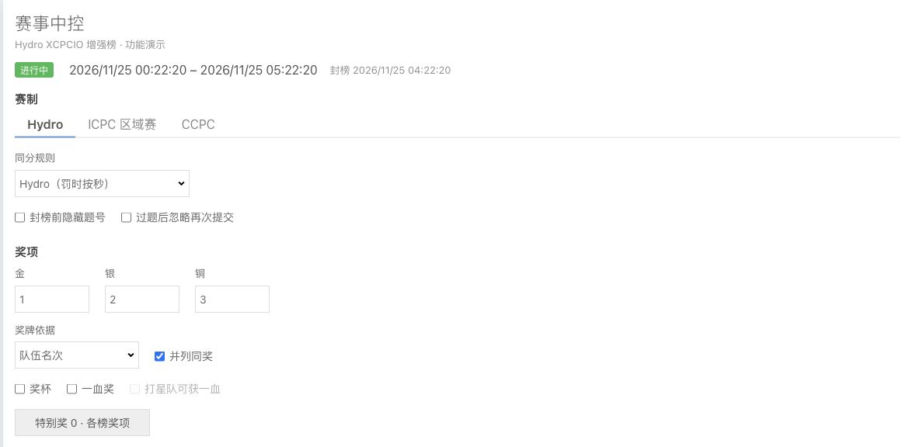

- **状态**：显示未开始、进行中、封榜中、已结束 · 封榜中、已结束。比赛结束后封榜不会自动解除，主持人滚榜完成后点“解除封榜”，所有观众随即看到最终榜单，公开的选手屏幕和暂缓的气球也随之放行。
- **赛制**：选择 Hydro、ICPC 区域赛或 CCPC，一次切换同分规则和相关设置。CCPC 会开启封榜前隐藏题号、过题后忽略再次提交、按学校名次颁发奖杯、打星队可获一血，气球改为封榜后暂缓、统一的一血气球和按队配色。奖牌名额、分榜和公开设置保持不变。之后单项修改时，赛制标签不再选中。
- **奖项**：奖牌名额与依据（队伍名次或学校名次）、并列同奖、奖杯（依据、并列办法、名称）和一血。特别奖与各榜单独设置仍在“榜单与奖项”。
- **封榜与公开**：封榜后气球暂缓或继续发放，比赛中是否公开选手屏幕，以及公开榜单、显示学校和 CCS API。
- **分榜、气球、打印、画面采集**：学校榜和正式 / 打星榜、气球配送与小票、一血气球样式与按队配色、是否允许选手打印、画面采集与摄像头。
- **重测复核**：显示重测改变了几条提交，以及几个滚榜会话基于旧结果，并链接到“重测复核”页。
- **页面**：直达榜单、滚榜、大屏、机位监控、评测监控、赛况总览、答疑台和成绩导出。

## 规则

- 在“奖项与排名规则”设置比赛默认值，在“各榜奖项”展开目标榜并勾选“单独设置此榜奖项”即可覆盖全部奖项规则。未单独设置时继承比赛默认值。同分规则对整场比赛的所有榜单统一生效。
- 同分规则：
  - Hydro 规则（默认）：按通过题数，相同时罚时少者在前；罚时按秒累计（每题通过时间加每次未通过 20 分钟），罚时相同则并列，与 Hydro 原生榜单一致。
  - ICPC 区域赛规则：按通过题数，相同时总用时少者在前；总用时按分钟计（每题通过时间取整到分钟，加每次未通过 20 分钟）；仍相同时最后一题通过时间早者在前；再相同则并列。
  - CCPC 规则（CCPC 基本规则 4.1）：总用时按分钟计，与 ICPC 相同；题数和总用时都相同即并列。并列的队伍按最晚一次通过的时间（以 Hydro 记录的秒为准）先后排列，奖杯也按此顺序颁发（附录二）。
- 奖牌名额：固定数量时金、银、铜分别表示名额；按比例时表示有效队伍（本榜正式且至少通过一题的队伍）的百分比，各奖项分别向上取整，例如有效队伍 31 支、金 10% 时金奖 4 名。比例之和不能超过 100%。零过题不授奖，奖牌总数不超过有效队伍数。滚榜按最终结果计算名额，榜单按当前可见结果计算。
- 默认并列同奖：规则无法区分的队伍（名次相同）获同等奖项，后续名次顺延；关闭后严格按名额划分奖牌。
- 学校名次（CCPC 基本规则 4.2）：只取各校成绩最好的正式队排出学校名次，同校其他正式队取其位置之后的学校名次（并列）。例如总榜依次为甲校一队、甲校二队、乙校一队、丙校一队时，学校名次为甲 1、乙 2、丙 3，甲校二队与乙校一队并列 2。成绩表、CSV、滚榜和 CCS 使用同一结果。
- 奖牌依据默认是队伍名次；改为学校名次时，金、银、铜名额表示学校名次范围，例如 CCPC 总决赛的 10、20、30（学校名次 1–10 金奖、11–30 银奖、31–60 铜奖）。
- 奖杯默认关闭。开启后按名称依次颁发（默认冠军、亚军、季军，可填 1 至 10 个），只授予至少过一题的正式队。依据可选队伍名次，或学校名次（每校只取最好的正式队）。规则无法区分的队伍可以“最晚通过早者得”（CCPC 附录二，其余顺延），也可以“共享”（后续奖杯顺延）。增强榜、滚榜、直播、CCS 和成绩导出颁发相同的奖杯。
- 一血奖默认关闭。开启后按当前榜内符合资格的最早通过计算，同一时刻通过者共同获奖。各榜的“允许打星选手获一血奖”独立生效，默认关闭。
- 打星选手显示星号，正式名次及奖牌名额顺延。旧 `unofficialAwards` 配置迁移为一血资格，新的 `unofficialFirstSolve` 字段优先。
- 学校来自用户学校字段，仅做 Unicode 和空白归一化。简称与全称应在用户资料中统一。
- 正式资格来自本场比赛的 `unrank` 状态。手动分组不会修改用户资料或参赛资格。
- 未填写学校的选手进入“未填写学校榜”；空手动榜可保留。
- 公开 JSON 会将封榜时刻之后的提交结果替换为 `FROZEN`，据此计算可见奖项。`realtime=true` 延续 Hydro 的隐藏榜权限检查。
- 每次刷新读取当前比赛 journal，重判结果会重新计算，同一提交不会重复计罚。公开 JSON 在最多 5 秒内共享同一次计算结果，保存设置后立即失效（多进程部署时同样如此）。
- 罚时与 Hydro 原生 ACM 规则一致：只有编译错误、格式错误和取消不计罚时，系统错误、未知错误、被 Hack 和忽略都计。Hydro 同分规则下罚时按秒累计和比较，榜上显示为分钟，因此显示相同分钟数的两名选手可能名次不同；ICPC 同分规则下按分钟比较。
- 个人计时比赛（设置了时长）与 Hydro 原生榜一致，提交时间从比赛开始时间算起，而不是每位选手自己的开始时间。
- 保存设置时，已不在参赛名单中的手动分榜成员会被自动移除；手动分榜不能互相重名，也不能与“正式参赛”或学校榜等自动分榜同名。
- 分榜用于公开榜单的展示筛选，所有榜共用当前比赛的可见参赛数据。
- 开启公开访问即公开该场比赛的榜单，无需登录、域权限、报名或参赛资格；比赛开始前公开链接不可访问（所有者和有隐藏榜权限的用户除外）。管理设置仍要求所有者或编辑比赛权限；公开接口拒绝 `realtime=true`。

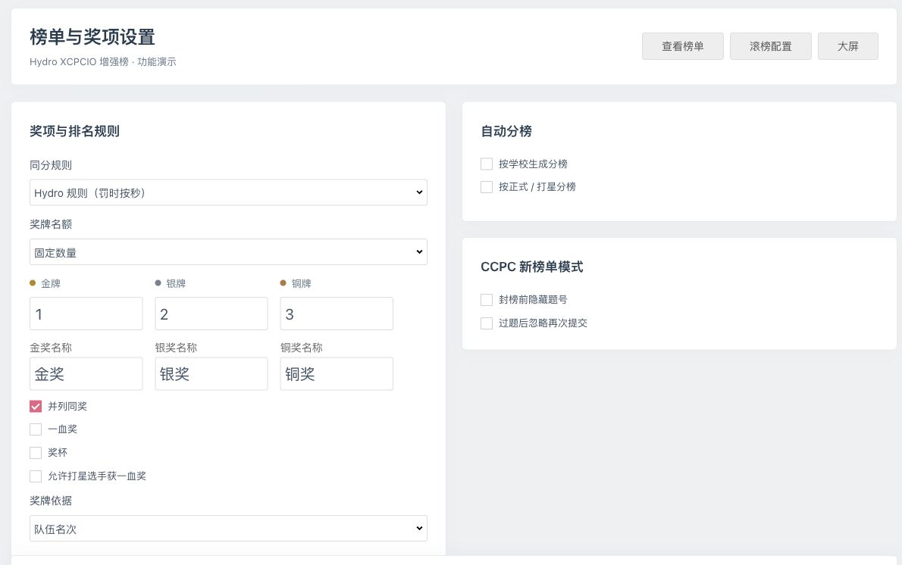

### CCPC 新榜单模式

在“榜单与奖项”的“CCPC 新榜单模式”或赛事中控开启“封榜前隐藏题号”后，比赛开始到封榜前，公开榜单按以下方式显示：

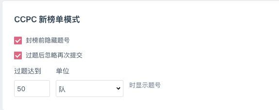

- 某题通过的队伍数达到门槛（默认 50 队，也可设为队伍数的百分比，下取整）之前，榜单不显示该题题号。
- 每支队伍的格子按各自的顺序排列：先是已显示题号的题目，按题号排列；再是本队通过的其他题目，按通过时间先后；再是本队提交过的其他题目，按最晚一次提交先后；最后是未提交的题目。未显示题号的列没有表头。
- 一血标记只用在已显示题号的列上。
- 封榜后与原 XCPC 模式相同：显示全部题号，封榜后的提交显示为封榜。
- 大屏和直播读取同一份数据。封榜前不显示气球配送图，CCS API 的公开视图也不公开榜单。比赛管理员的实时榜、滚榜、成绩导出和管理页面始终显示真实题目。
- 这段时间里，Hydro 原生榜单一律跳转到增强榜，即使比赛关闭了“替换 Hydro 原生榜单”。原生榜单的 HTML、CSV 导出只对比赛管理员开放。

“过题后忽略再次提交”可以单独开启：队伍通过某题后，再交该题的提交不计入提交次数，也不出现在榜单、滚榜、大屏、直播和导出中。

### 特别奖

在比赛侧边栏打开“榜单与奖项”，在“特别奖”点“添加特别奖”，填写名称并选择获奖方式。每场可设置 20 个特别奖。

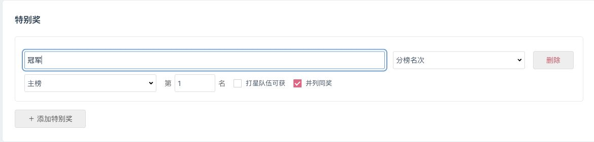

| 方式 | 计算规则 |
| --- | --- |
| 分榜名次 | 在所选分榜给至少过一题的第 N 名队伍颁奖，例如女队榜第 1 名。可允许打星队伍参加该奖的名次计算。 |
| 最后一个通过 | 在所选分榜的正式队伍中，比较每队每题的首次通过时间，取最晚一次。同秒通过可并列获奖。 |
| 有过题的最后一名 | 取所选分榜中至少过一题且排名最末的正式队伍。 |
| 指定队伍 | 从参赛名单选择，可给多队颁奖。 |

分榜名次按比赛设置的同分规则计算。勾选“并列同奖”时使用榜上名次，并列后的名次顺延。关闭时按队伍的排序位置取一队。两种“最后”规则都排除打星和零过题队伍。删除手动分榜会移除引用该分榜的规则奖。

比赛结束且结果已完成评测后，增强榜在排名表下方随刷新显示当前视图的获奖结果，公开榜和公开 CCS 在解封后公布。滚榜把特别奖作为荣誉奖项展示，CCS 的 `awards` 使用 `special-<ID>`，成绩与获奖名单 CSV 也会列出特别奖。

## 成绩与导出

比赛所有者和有“编辑比赛”权限的管理员可从比赛侧边栏打开“成绩与导出”。快照保存参赛名单、各题提交和当时的榜单规则。比赛结束、解除封榜、从插件执行影响本场比赛的批量重测前都会自动保存，也能在此手动拍快照。服务重启后会补拍最近 24 小时内尚无结束快照的比赛，界面显示实际拍摄时间。

- 选择“对比基准”“成绩来源”和分榜，可比较两个快照或将快照与当前成绩比较。查看名次、过题数、罚时、奖牌、一血及特别奖的变化，以及受影响的提交。默认显示有变化的队伍。
- 没有快照的批量重测，可选择“重测前还原”。还原使用当前参赛名单、分榜和奖项规则回推日志中的提交判定，因此结果会标记为暂定。
- 成绩表含名次、学校名次、奖杯和奖牌，CSV 还有队伍、学校、队员、过题数、罚时、各题尝试次数与通过时间及其他奖项。获奖名单 CSV 按奖项列出队伍、学校、队员和可用的教练信息。CSV 带 UTF-8 BOM，可直接用 Excel 打开。
- “全部代码”打开 Hydro 自带的全量比赛代码导出。

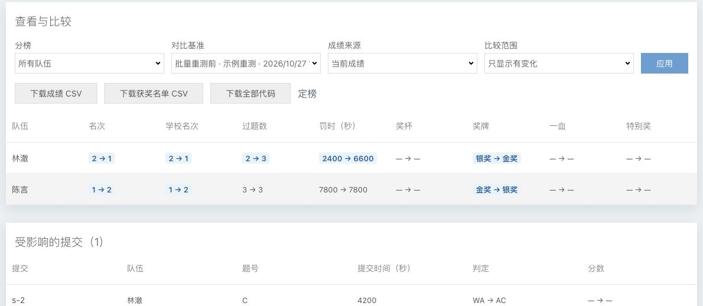

### 重测复核

从赛事中控进入“重测复核”（`/contest/<比赛ID>/rejudge-review`），可以检查用“批量重测”对本场比赛做过的重测。

- 列出结果有变化的提交：队伍、题目、提交时间、原结果、重测结果、当前结果，以及名次和奖项的变化（与这些变化都不发生时相比）。影响名次或奖项的行会突出显示。仍在评测的提交只计数。
- 可按题目、变化类型（AC → 非 AC、非 AC → AC、其他）、处理状态和“影响名次或奖项”筛选，勾选后批量“恢复原结果”，或把已恢复的“改回重测结果”。不处理时按重测后的结果显示。恢复会同时更新提交记录和比赛成绩，操作前自动保存一份成绩快照。这两项操作需要重测权限。
- 在最近一次结果变化之前创建的滚榜会话标为“基于旧结果”。“用当前成绩重建过期会话”按原会话的设置新建会话，原会话保留，新会话属于操作者。

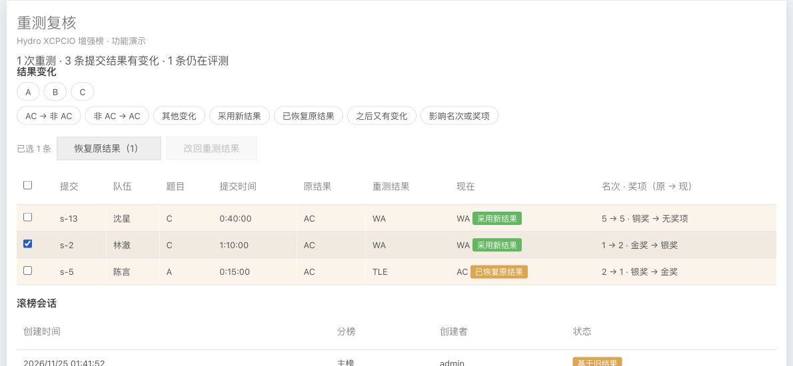

## 响应式界面

通过下拉框切换分榜，手动分榜排在学校榜之前；宽度不足 1024px 时（手机和竖屏平板）将学校、过题数和罚时集中在姓名下方，姓名显示一行，把宽度留给题目成绩；桌面的学校列和题目列随窗口宽度伸缩；横向滑动表格时固定名次和选手信息列。手机端的比赛起止时间默认收起，点击“比赛时间”展开，功能入口等宽排列。多题目榜单在表格内滚动，不撑宽整页。设置页自动切换为单列，支持触屏筛选和底部保存栏；详情与选项弹窗适应可用屏幕高度。

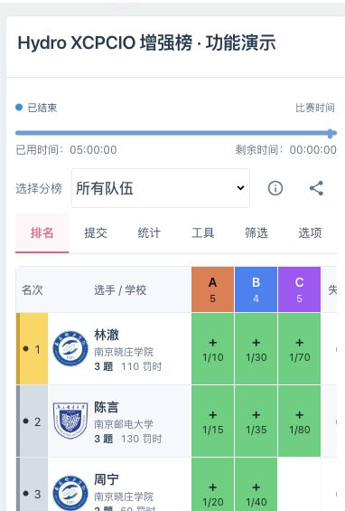

题目表头使用比赛在 Hydro 中设置的气球颜色（比赛管理 → 气球 → 设置颜色），文字颜色自动取黑或白；未设置颜色的题目表头与其他表头一致。首次通过单元格使用深绿色高亮，不叠加文字；题目统计可按需展开，默认优先显示排名。长名称在桌面最多显示两行、手机和平板显示一行，可点击查看完整资料；长榜使用一致的行高，滚动时保持稳定。

比赛时间、切榜、信息与分享集中在表格上方的一行，图例放在表格下方。成绩单元格使用饱和的底色（通过为绿色、首次通过为深绿色加描边、未通过为红色、评测中为蓝色、封榜为黄色），金银铜名次使用对应的醒目底色和色条，深色模式下同样清晰。信息与分享按钮支持键盘操作和手机触控。设置页优先显示奖项规则与自动分榜，后续为访问方式和手动分榜；已有分榜的成员列表默认收起，展开后继续支持全部批量筛选操作，并可切换为只看已选成员。

封榜期间，所有者和有隐藏榜权限的用户会在榜单页看到“查看实时榜”入口，实时榜上有“返回封榜视图”。比赛结束后，所有者和有编辑比赛权限的管理员可点击榜单页的“解除封榜”（Hydro 原生解封，确认后不可撤销），公开榜、大屏、直播和 CCS API 随即显示全部结果；比赛结束前按钮不可用。

页面继承目标 Hydro 的导航、字体和浅色 / 深色设置。XCPCIO 自带样式在构建时限制在榜单内，避免改变站点其他区域；静态资源使用版本目录，升级后自动更新。

## 学校 Logo

Logo 来自 Hydro 的学校 Logo 注册表 <https://avatar.hydrooj.com/>，保留源图分辨率，随包发布在 `logos/` 目录。已有 WebP 保留原始文件，其他格式无损转换为 WebP，并保留透明通道。Resolver 使用这套原图，适用于高清屏幕和奖项大图；增强榜只把校徽显示为行内图标，使用 `logos/thumb/` 中 128px 高的缩略图，每张约 7 KB，避免观众为小图标下载原图。源图地址及文件哈希记录在 `logos/index.json`。

安装包包含榜单缩略图、`public/hydro-resolver/logos/` 下供滚榜、大屏及直播使用的校徽，以及 CCS API 使用的 PNG（`logos/png/`），解压后即可使用。自 1.12.0 起，安装包不再重复附带 `logos/` 原图、`live/dist/` 和滚榜字体图片的源副本，体积约为此前的一半；这些源文件在仓库中，`pnpm build` 或 `pnpm pack` 会由它们重新生成 `public/`。

校徽按学校名称（含注册表中的别名和英文名，忽略全半角、大小写和多余空格）匹配。增强榜中名称不在注册表的学校不显示 Logo，未填写学校显示 XCPCIO 自带的 ICPC 标志。Resolver 缺失校徽时使用本地 ICPC 图标。未开启“向所有观众显示学校”时增强榜的学校列和 Logo 均隐藏。


更新 Logo 需要本机安装 `cwebp`（libwebp），然后执行：

```bash
pnpm logos
pnpm build
```

“提交”页的隐藏在页面上完成：榜单排名本身需要每条提交的时间和（比赛中已模糊为“未通过”的）结果，所以这些数据仍在榜单 JSON 中，只是不再提供逐条浏览的界面。

## 本地预览

```bash
pnpm build
pnpm preview
```

打开 <http://127.0.0.1:18900/>。演示提供虚构的 8 名选手、3 道题、学校、年级、班级和用户组资料，可实际筛选、保存并切换榜单；演示设置写入 `preview-state.json`。

设置页：<http://127.0.0.1:18900/contest/demo/xcpcio-settings>

公开榜：<http://127.0.0.1:18900/contest/demo/xcpcio-public>

宽榜演示（64 人、15 题、长学校与选手名）：<http://127.0.0.1:18900/contest/demo/xcpcio-public?fixture=wide>

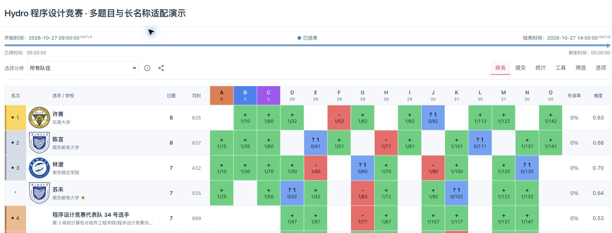

系统管理演示（内存模拟数据，删除确认使用演示管理员密码 `preview-admin`）：<http://127.0.0.1:18900/manage/xcpcio-users>、<http://127.0.0.1:18900/manage/xcpcio-judges>、<http://127.0.0.1:18900/manage/xcpcio-rejudge>

本地预览使用官方 `@hydrooj/ui-default@4.58.5` 的样式；生产环境使用站点已安装的 Hydro 主题。

预览服务仅用于界面验收，绑定本机地址，不包含 Hydro 的账户权限系统。正式使用应安装到 Hydro。

## 验证范围

界面已在 Browser 内置浏览器中验收桌面、平板、手机布局和深色模式；响应式尺寸模拟不能替代真实手机设备测试。

自动测试覆盖样式隔离、主题选择、动画与伪元素，以及总榜奖牌、各榜一血资格、独立奖项与名额递补、学校/资格/手动分榜、组内一血、并列、零过题、重判、封榜边界、非法配置、成员检查、脚本内容转义、修改权限、实时榜权限、跨域隔离及重新加载后的设置保留，以及组合筛选、批量选择、匿名公开访问和默认榜单提前跳转。奖项测试执行与前端相同扩展的实际 XCPCIO 引擎；构建时校验上游入口，避免升级后静默失效。

单元测试使用 Hydro 宿主与数据库替身。插件代码同时对 Hydro 5.0.7 与 5.1.0 的接口做类型检查，监听的 Hydro 事件在两个版本中逐一核对；CCS API 按 ICPC CCS Contest API 2026-01 的官方 JSON Schema 校验。另在真实 Hydro 5.0.7 上验证插件加载、滚榜流程和原有榜单，并在真实 MongoDB 上完成双进程并发、恢复、成绩快照分块存储、答疑认领冲突和气球租约测试。详见 `verification.md`。

## 开源许可

插件为 AGPL-3.0-or-later；XCPCIO 前端保留 MIT 许可。来源和许可见 `NOTICE`、`LICENSE` 与 `licenses/XCPCIO-MIT.txt`。


## Resolver 滚榜

0.7.0 集成 Resolver-Web v1.4.0 的滚榜引擎和 Canvas 播放画面。比赛页右侧的“滚榜”入口位于“(CCS) 重置比赛”之后。缺少 CCS 时位于“比赛管理”之后。只有 ACM 比赛所有者和有“编辑比赛”权限的账号可使用。

```text
/d/<域ID>/contest/<比赛ID>/resolver
```

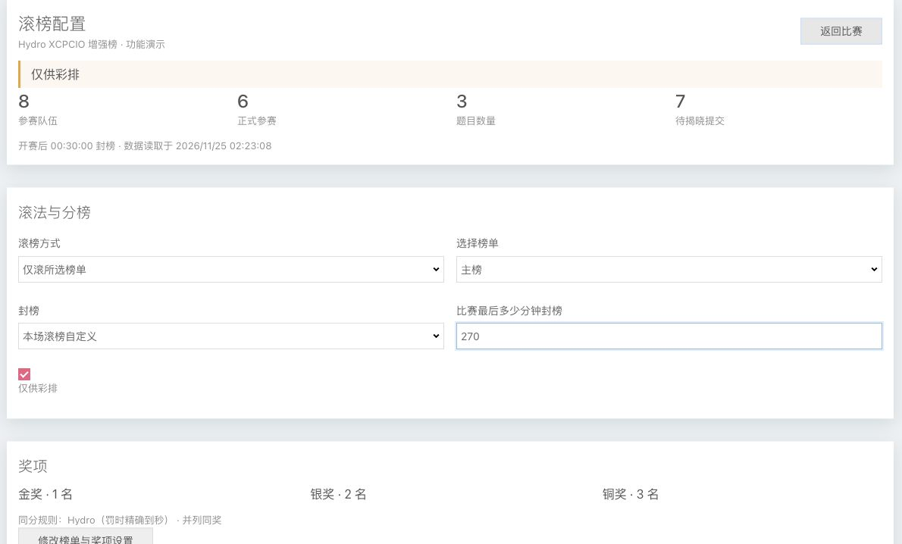

1. 选择“仅滚所选榜单”，展示主榜或指定分榜的成员并保留参赛身份。选择“所选分榜正式，其余非正式”则展示全部成员，只有分榜内原本正式的成员参与正式排名、奖牌和奖杯。打星一血资格使用所选分榜的规则。
2. 默认继承比赛封榜点。没有封榜设置时，选择“本场滚榜自定义”并填写封榜时长，即比赛最后多少分钟封榜，页面会显示换算出的封榜时刻。恰好在封榜点的提交可见，之后的提交隐藏。该选项作用于当前滚榜。
3. 奖项区显示所选榜单的共享规则，通过“配置榜单与滚榜奖项”统一修改。预览与开始时重新读取设置。“选手名后显示学校”默认开启，学校未填写时只显示名字。
4. 默认每屏 12 行，手动播放。启用自动阶段后默认 4 倍速，可调整至 0.25–16 倍。即时预览与播放使用同一引擎和绘图模块。
5. 点击“开始滚榜”重新读取最新数据，固定比赛、成员、打星状态、配置与步骤。后续提交、重判及分榜修改需新建会话才能纳入。
6. 比赛结束前自动作为彩排并标注“仅供彩排”。彩排忽略未完成评测的提交并提示数量。结束后可选择彩排，正式滚榜要求相关提交全部评测完成。
7. 从当前管理员会话列表继续或删除会话。默认永久保留，插件配置 `resolverSessionDays` 为 `0`。需要自动清理时可显式设置 1 至 365 天，清理会检查最近使用时间，保护并发打开或推进的会话。刷新、重启和多进程恢复后从已保存步骤开始并暂停。发生版本冲突或断线时停止推进。

主持页点击“投到观众屏”绑定当前会话，再点“打开观众屏”投影。也可以在大屏管理的“滚榜观众画面”选择自己的正式会话或彩排。观众中途加入时加载已揭晓的内容，连续前进时只接收新增步骤，回退、换场和断线后自动校对进度。

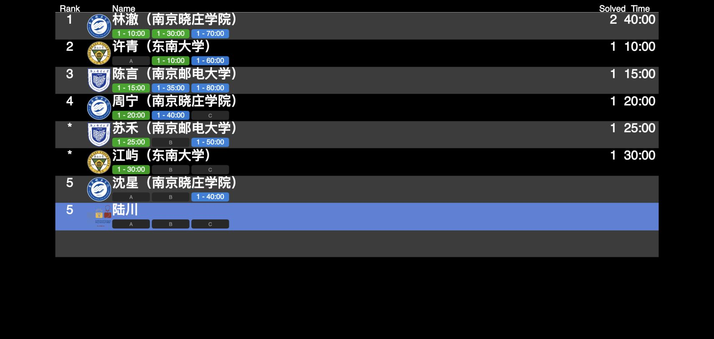

播放支持上游键盘操作、前进、回退、自动推进、奖项和显示设置。页面中的帮助按钮列出快捷键。配置与播放均嵌入 Hydro 的页面框架，使用原生分区、表单、按钮及明暗主题。滚榜画布保留上游绘图和动画，支持在页面内播放或全屏展示。播放样式限制在当前区域，学校 Logo、ICPC 图标和字体随安装包提供。MongoDB 集合 `xcpcio.resolver.sessions` 保存元数据与版本，`xcpcio.resolver.chunks` 分块保存快照及步骤，每块数据最多 4 MiB。会话保留至创建者删除。数据库备份需同时包含两个集合。

### Resolver 来源与许可

固定来源为 Resolver-Web v1.4.0，commit `d4a1a80fa1c0a7b0013f941256004ba5f63c6773`。原始文件 SHA-256 和修改后 SHA-256 见 `resolver/UPSTREAM.json`，修改清单见 `resolver/CHANGES.md`。本插件源码随安装包提供。

插件原有集成代码继续适用 AGPL-3.0-or-later，XCPCIO 继续适用 MIT。Resolver-Web 的 Apache-2.0 和原 MIT 声明保存在 `licenses/`。源自 ICPC Tools 的引擎、绘图和 Helvetica 字体、ICPC 图标继续适用 ICPC Software License。该许可证要求非商业使用，商业或创收使用须取得 ICPC Foundation 的书面例外授权，同时要求公开使用者的源码并在所有分发版本中保留许可证。Noto Sans SC 采用 SIL OFL 1.1。学校标志属于相应学校。各组件适用范围与许可证路径见 `NOTICE`。

验证过程与验收范围见 `verification.md`。

## 大屏

比赛所有者和有“编辑比赛”权限的管理员可在比赛侧边栏的“大屏”进入管理页（`/contest/<比赛ID>/screens`）。

管理页右侧按用途列出全部画面。点击画面后，左侧显示设置、投屏链接、“复制链接”、“预览”和“新窗口打开”。设置修改后自动保存，预览总是显示最新设置。画面语言和作废链接操作作用于全部画面；海报选择图片后直接上传。

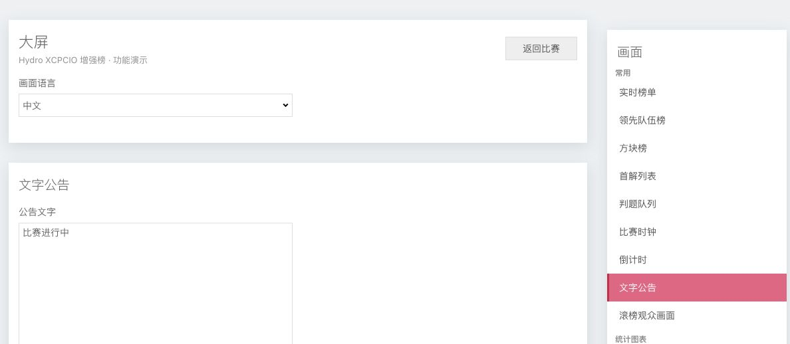

| 画面 | 可设置项 |
| --- | --- |
| 实时榜单 | 分榜；按页自动滚动 |
| 领先队伍榜 | 分榜；前 12 名 |
| 方块榜 | 分榜；实时方块榜、按通过数分组、按队名排列 |
| 首解列表 | 分榜 |
| 判题队列 | 分榜；判题队列（最近提交逐行滚动）或队伍判题（7×3 网格，只显示打开画面之后的新提交） |
| 比赛时钟 | 比赛已进行时间 |
| 倒计时 | 数字或环形；倒计时到比赛结束、比赛开始或指定时间，到点后转为正计时 |
| 文字公告 | 公告文字，可换行 |
| 滚榜观众画面 | 跟随的滚榜会话（从当前管理员的会话中选择） |
| 题目通过统计 | 分榜、柱状图或 ICPC Tools 题目卡片 |
| 排名走势图 | 分榜；按 Hydro 计分规则抽样显示当前前五名有通过记录的正式队伍名次 |
| 评测结果分布 | 分榜、按比赛时间或按题目显示结果数量 |
| 分组排行轮播 | 分榜、按已配置的分榜或按学校分组、逐组轮播或看各组领先、切换间隔 |
| 学校 Logo 墙 | 分榜、墙面、淡入或横向滚动；读取本地校徽库 |
| 队伍巡礼 | 分榜、切换间隔；展示队名、队员及公开榜允许显示的学校 |
| 题目与气球颜色 | 读取比赛气球管理中的颜色，轮播各题气球 |
| 赛场平面图 | 分榜、过题数与最新结果或逐题通过状态；按导入座位号的前缀自动分区 |
| 气球配送图 | 分榜；按座位显示待配送且榜单可见的气球（开启“气球配送”时来自那里，否则来自 Hydro 气球记录），气球以题目颜色的实心圆显示；座位格按屏幕大小自动铺满，字号随格子缩放 |
| 通过播报 | 分榜、全部通过或只播报一血、切换间隔 |
| 评测机状态 | 评测队列、在线状态、负载及错误计数；以编号标识机器 |
| 图片海报 | 切换间隔；最多上传 20 张 PNG、JPEG 或 WebP 图片，每张最大 2 MiB，按上传顺序轮播 |
| 比赛公告滚动 | 切换间隔；仅显示裁判发给所有选手的公告 |
| 题目列表 | 题号、标题、气球颜色和时空限制 |

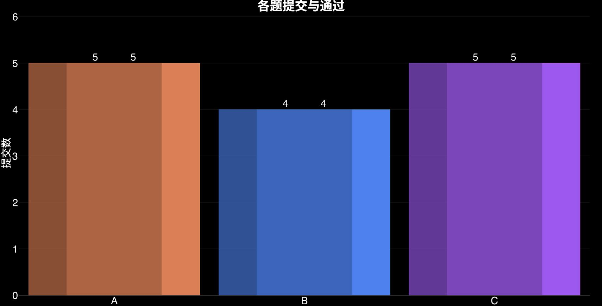

- 每种画面有一个固定链接，在大屏电脑的浏览器中打开即可显示，无需登录 Hydro。点击画面、右上角“全屏”按钮或按 F 进入全屏，Esc、F 或双击退出；按钮和鼠标指针在 3 秒无操作后自动隐藏，移动鼠标重新出现。浏览器只允许由点击或按键触发全屏，打开链接后需要点一下画面；无人值守的大屏可用 Chrome / Edge 的 `--kiosk` 启动参数直接全屏打开链接。链接不区分屏幕，同一链接可在多台电脑上同时打开。
- 设置自动保存，已打开的大屏在 3 秒内（滚榜观众画面 1 秒内）更新。修改某个画面的设置会影响所有打开该链接的屏幕。
- 榜单类画面使用与公开榜相同的数据：封榜后冻结，选手名显示显示名，按“向所有观众显示学校”决定是否显示学校；比赛开始前只显示“比赛尚未开始”。即使比赛没有开启公开榜，带令牌的链接也能看到这些冻结数据。
- 判题队列会公开显示谁在何时提交了哪道题。结果可见程度与公开榜一致：比赛中错误结果只显示为未通过，封榜后的提交显示为待定，正在评测的显示为评测中。比赛中如不希望选手看到，请只在裁判室使用。
- 榜单类画面的一血高亮跟随所选分榜的奖项规则：该榜关闭一血奖时不高亮；首解列表始终列出各题最早通过，打星选手只在该榜允许打星获一血奖时计入。
- 滚榜观众画面是场馆的滚榜显示，与主持端画面一致，显示创建会话的管理员能看到的选手名、学校和校徽，不受“向所有观众显示学校”影响。链接外传即可看到这些信息，请妥善保管。
- 比赛时钟、倒计时和榜单顶部的时间按总小时数显示（例如 95:59:59），多日比赛不会回绕。
- 滚榜观众画面只读跟随主持端进度，看不到尚未揭晓的步骤和获奖名单，也没有控制权。
- “作废并重新生成全部链接”会让所有旧链接立即失效。
- 画面语言可选中文或英文，作用于全部画面。大屏打开后先用系统中文字体显示，随包的 17 MB 中文字体在后台加载完成后自动替换，字形可能有细微变化。
- 场馆画面读取 onsite-toolkit 导入的座位号。队伍没有自己的座位时，用第一位有座位的队员的座位。平面图是按座位号排列的示意图。平面图与配送图会向持有链接的人显示座位号，请按场馆需要发放链接。
- 气球配送图：比赛开启了“气球配送”（见下一章）时显示其中待配送的气球和那里设置的颜色；未开启时读取 Hydro 自带的气球记录（需在比赛“气球”中设置颜色，Hydro 封榜后不再生成，解除封榜也不补发）。两种情况都只显示公开榜可见的通过。
- 海报上传或移除会立即更新该比赛的海报列表。重新生成链接后，已上传海报可以通过新链接访问。

## 气球配送

比赛所有者或有编辑比赛权限的管理员从比赛右侧菜单的“气球配送”进入（`/contest/<比赛ID>/balloons`）。首次进入点击“开启气球配送”。

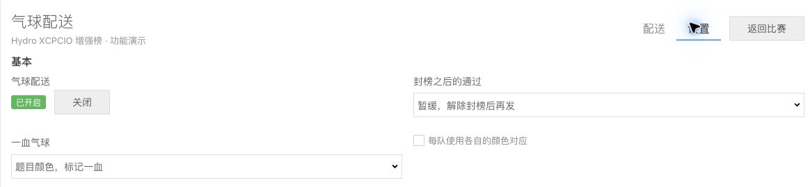

**气球从哪里来**：插件自己跟踪气球，不依赖 Hydro 的气球记录。比赛期间每支队伍每道题的第一次通过产生一个气球，编号 #1、#2… 按出现顺序递增，方便口头核对。
- 不需要设置 Hydro 气球颜色。封榜之后的通过默认暂缓，显示为“封榜暂缓”。比赛结束后仍然暂缓，直到解除封榜才转为待配送，小票也在那时打印。如需封榜后继续发放，可在设置中改为“继续发放”。
- 重测把通过改为未通过时气球显示为“已撤销”，未打印的小票不再打印；已送出的气球请收回。改回通过后气球恢复。
- 在 Hydro 自带气球页标记的送达会同步过来；在这里标记送达或撤销，也会同步到 Hydro 的气球记录（比赛设置了气球颜色时 Hydro 才有记录）。
- 评测结束后几秒内出现（多进程部署下由一个进程汇总，其他进程的页面同样更新）；页面每 3 秒刷新，没有变化时只传一个版本号。

### 基本模式：按考场和题目配送

- **各考场待配送**：表格的行是考场（座位号去掉末尾数字的部分，如 `A-12` 属于 A，取自 onsite-toolkit 导入的座位），列是题目（气球颜色和颜色名），格子是待配送的气球数。点数字、考场名或题目即可筛选，用于给各考场分配配送员和备好对应颜色的气球。
- **筛选**：考场与题目可多选；状态可选待配送、已送达、封榜暂缓、已撤销或全部；可搜索队伍、座位、学校或气球编号。筛选条件保存在本浏览器。
- **按队伍**：每支队伍一张卡片，按座位排序，显示座位、队名、学校和气球（题号 + 颜色名，★ 为本题一血）。点击待配送的气球即标记送达，点击已送达的气球可撤销；一张卡片有多个待配送气球时可“全部送达”。
- **按时间**：按通过顺序列出（待配送的最早在前），可勾选后批量标记送达或补打小票。
- **配送员链接**：设置中的“配送员链接”免登录即可查看并标记送达（适合手机），志愿者不需要 Hydro 账号或“编辑比赛”权限；可填写自己的名字，记录在送达信息中。链接只能查看和标记，不能修改设置；可随时“作废并重新生成”。关闭气球配送后链接暂停使用。

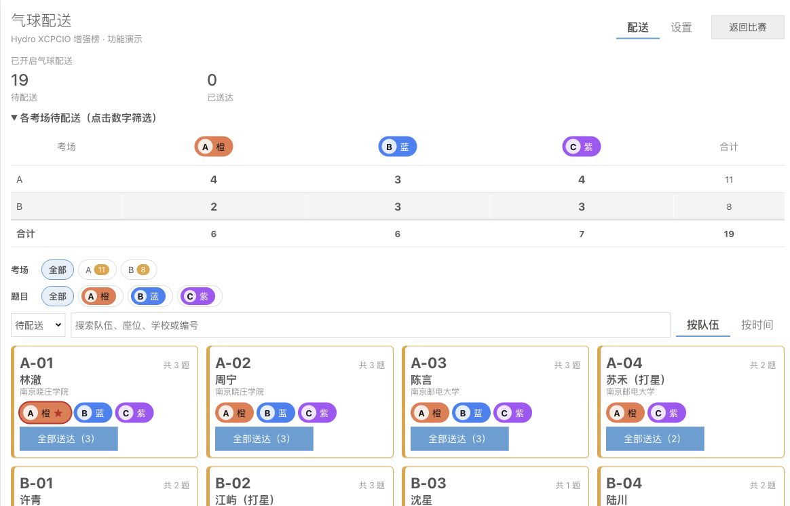

### 小票机模式：过题后自动打印配送小票

1. 系统管理员在“打印服务器管理”中，把连接在打印电脑上的热敏小票打印机的“类型”设为“小票机”，选择纸宽（58 或 80 mm）、输出方式和是否自动切纸，点“测试小票”确认（见“打印服务器管理”）。小票机只打印气球小票，不参与代码打印。
2. 在气球配送的“设置”中勾选“开启小票打印”并保存。此后每出现一个新气球，就在分配到的小票机上打印一张小票；开启前已有的气球不会自动补打，可点“为未送达的气球补打小票”。
3. **分配方案**：规则按顺序匹配，第一条“考场前缀”和“题目”都符合的规则决定打印到哪些小票机（考场前缀留空表示所有座位，题目不选表示所有题目；选多台时按气球均匀分摊，同一张小票总落在同一台上）。规则中的小票机都不可用时，小票等待其恢复。没有规则匹配时，小票打印到为该座位服务的打印服务器（“打印服务器管理”中的座位范围）上的小票机，与代码打印的分工一致，所以各考场一台打印电脑、各接一台小票机时无需设置规则。
4. 志愿者拿小票去送气球，送达后在气球页面（或配送员链接）标记。已送达的气球不再打印小票；打印失败会自动重试，3 次后显示“打印失败”，可点“补打”。

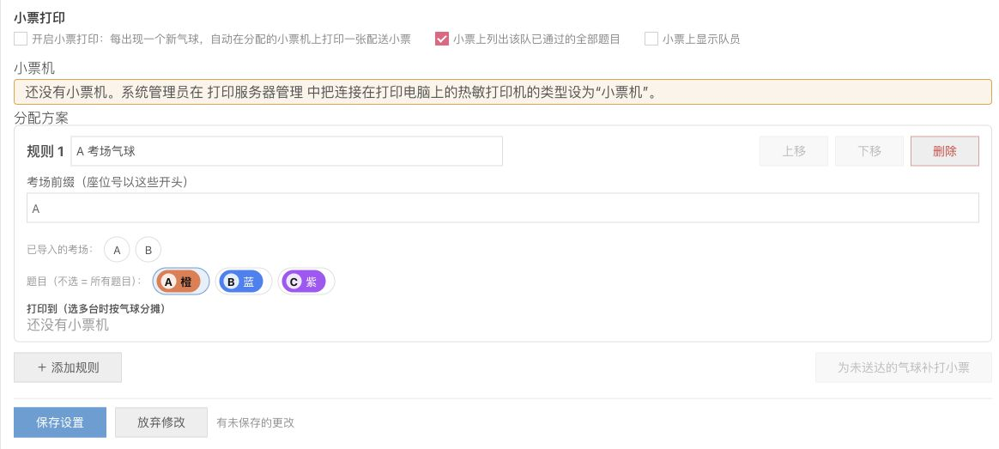

小票内容：比赛名、气球编号、**座位**与**题号·颜色名**（大字）、本题一血标记、队名（打星注明）、学校、题目名、通过的比赛时间，可选“该队已通过的全部题目”和队员。补打的小票注明补打次数。

**一血气球与按队配色**（CCPC 新榜单模式）：“一血气球”可选“题目颜色，标记一血”（默认）、“统一的一血气球”（所有一血都用同一种颜色，与其他气球不同），或“统一的一血气球，按全场顺序编号”（印 1、2、3… 或 A、B、C…，表示全场第几个一血，与题号无关）。勾选“每队使用各自的颜色对应”后，每支队伍的题目与气球颜色对应关系各不相同，由比赛的颜色随机打乱，选手无法提前推算。气球页和小票显示该气球实际要发的颜色。这两种方式下不显示气球配送图大屏。

**气球颜色**：设置中可为每道题单独设置颜色和颜色名称（如“红”“浅蓝”，印在小票上；不填名称时按颜色自动命名），也可一键从 Hydro 比赛气球颜色导入。未单独设置的题目使用 Hydro 的气球颜色。气球配送图大屏也使用这里的颜色。

## 组队比赛

Hydro 5.1 起支持组队比赛（比赛设置中允许组队）。组队参赛时，队伍在榜单、滚榜、大屏和直播中按队名显示，并附带队员：

- 队名是公开信息，始终显示；队员显示各自的显示名（未设置时为用户名）；学校跟随“向所有观众显示学校”。队伍的学校取多数队员所在的学校。
- 增强榜：表头显示“队伍 / 学校”，鼠标悬停在队名上显示队员，点开队伍详情可看到队员列表。
- 滚榜：队伍获奖画面在队名下方显示队员。
- 直播：队员写入队伍的自定义字段，标题字幕模板可用 `{team.customFields.members}` 引用，导播台的比赛信息中也能看到。
- 组队比赛中单独参赛的选手，以及非组队比赛，仍是一人一队，显示方式不变。Hydro 5.0 没有组队比赛，插件在两个版本上都能使用。

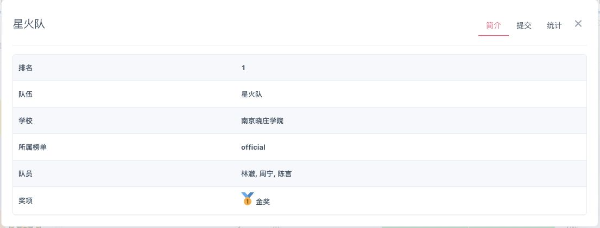

## 机位监控

比赛所有者和有“编辑比赛”权限的管理员可在比赛侧边栏的“机位监控”进入（`/contest/<比赛ID>/presence`），仅支持 ACM 比赛，页面每 5 秒刷新。它回答两个问题：每支队伍的电脑现在是否在线，以及哪里不对劲。

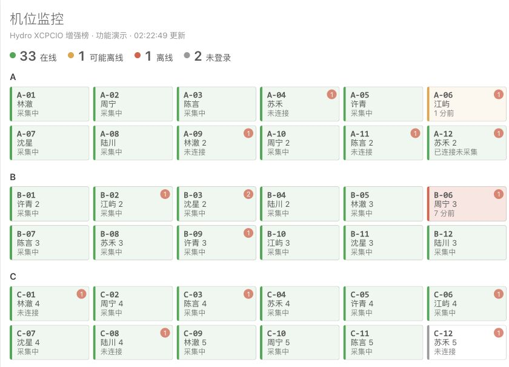

- 参赛者打开比赛页时签到，页面每 20 秒发送一次在线心跳。同一浏览器的多个比赛标签页共用心跳。机位监控显示在线、可能离线（90 秒没有心跳或设备连接）和离线（3 分钟），从未打开比赛页的队伍显示未登录。浏览器会把后台页面的计时器压到约每分钟一次，所以浏览器放在编辑器后面时仍显示在线。
- 启用画面采集后，详情显示“采集中”“已连接未采集”或“未连接”。采集中表示至少一台绑定设备正在共享屏幕。独立采集窗口可在比赛页切换、最小化或关闭后继续工作，实时设备连接也计为在线。停止屏幕共享后可在采集窗口重新授权。未启用采集的比赛只显示签到和在线状态。
- 座位图：按考场分组（座位号去掉末尾编号后的前缀，与气球配送相同），座位号按自然顺序排列，没有座位的队伍排在最后。格子颜色表示状态，右上角数字为告警数；可能离线和离线的格子显示多久没有心跳，其余格子在启用采集时显示采集状态。点击格子查看队员、当前 IP、IP 登录绑定的地址、10 分钟内用过的 IP、浏览器版本、首次上线时间和画面采集状态。
- 告警（右侧列表，按严重程度排列，点击查看详情）：
  - 与其他队伍同一 IP：两支在线的队伍从同一个地址报告，通常是换了座位或共用电脑。
  - IP 与座位不符：队伍（或其队员）有 IP 登录绑定，当前地址却不在其中。
  - 离线、未登录：只在比赛进行中提示，并显示持续时间。
  - 10 分钟内多个 IP：可能换了电脑。
  - 画面采集：比赛进行中，在线机位的设备断开或已连接但没有共享屏幕时提示。
  - 浏览器过旧：Chrome、Edge、Firefox 低于 90，Safari 低于 14，或 Internet Explorer。
- 签到：比赛开始前，页面顶部显示“已签到 / 总数”，没有打开过比赛页面的队伍显示为虚线格子“未签到”，可在开赛前确认每台电脑都已登录。开始前不提示离线和未登录。
- 声音：点击“声音”开启后，出现新的同一 IP、IP 不符或离线告警时发出提示音；开启声音时，页面在后台标签页中也继续刷新。设置保存在本机浏览器。
- 系统管理员在详情中可跳转到“座位与 IP”修正座位和 IP 登录。

选手页面上的报告由插件的前端脚本发出（`frontend/presence.page.js`，随 Hydro 前端一同构建）；即使前端未重新构建，打开比赛页面本身也会被记录，只是页面停留期间不会持续报告。

## 答疑台

ACM 比赛的所有者和拥有“编辑比赛”权限的管理员可在比赛侧边栏打开“答疑台”。选手继续在 Hydro 原生比赛题目页提问和查看回复。答疑台、Hydro 原生答疑、大屏的公开公告和 CCS API 共用比赛的答疑数据。

1. 在“待回复”按题号、通用或技术问题筛选。列表显示队伍、座位和等待时间，超过 5 分钟标红。答疑台打开且在前台时每 4 秒刷新；打开“提示音”后，页面在后台标签页中也继续刷新，有新提问时响铃。页面同时显示各分类提问数和平均响应时间。
2. 点“标记处理中”认领，避免多名裁判重复处理。同一条提问只允许一人持有认领，10 分钟后自动释放，也可手动释放。管理员可解除其他人的认领。
3. 套用比赛配置的标准回复，或自行填写。默认模板包括“否”“是”“请仔细阅读题面”“无可奉告”和“不提供额外数据”。私下回复只回给提问队伍。需要同步给全体时，勾选“同时向全体发布公告”并填写单独的公开稿。
4. 在“公告”发布封榜、延时、题面更正等通知。公开稿会进入大屏的“比赛公告滚动”。开启直播的站点可把公开稿推送到直播滚动条，持续 5 分钟。

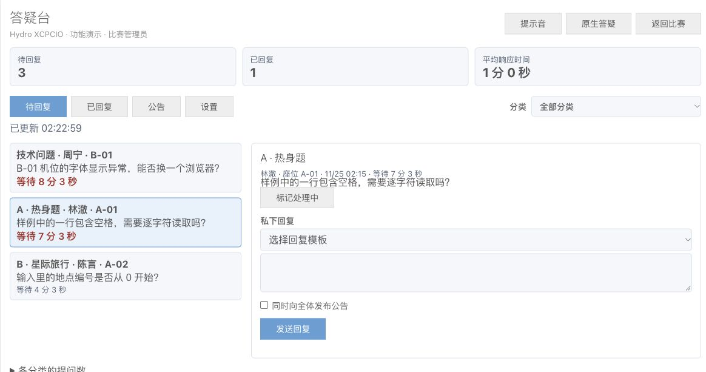

在“设置”可以修改回复模板（每行一条）、设置提前多少分钟自动公告封榜时间（0 表示关闭；公告写明北京时间的封榜时刻和剩余分钟数），以及按实际题号生成答疑员链接。收到链接的人员无需登录，可认领并回复该题提问，也能随回复发布本题公开稿。发布独立公告、推送直播与修改设置由比赛管理员完成。更换或删除链接后旧地址即刻失效，也可从“座位与 IP”的“免登录链接”随其他链接一起更换。

## 评测监控

比赛所有者和有“编辑比赛”权限的管理员可在比赛侧边栏的“评测监控”进入（`/contest/<比赛ID>/monitor`），页面每 3 秒刷新：

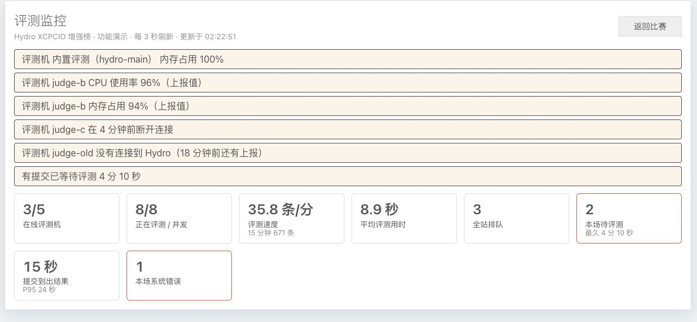

- 概览：在线评测机、正在评测的任务数与总并发、评测速度（最近 5 分钟每分钟完成数）、平均评测用时（评测机取题到出结果）、全站排队任务数、本场待评测数与最久等待、本场提交到出结果的平均与 P95 用时、本场系统错误。
- 评测机：每台一张卡片，显示状态（评测中 / 空闲 / 已断开 / 未连接）、登录账号与地址、连接时长、并发占用、CPU 与内存占用、最近 1、5、15 分钟的评测数、平均与最长评测用时、通过率、系统错误、CPU 温度、累计评测数、最近一次完成时间，以及最近 30 分钟每分钟评测数的柱状图；底部是机器型号、核心数、内存、系统和语言环境数，只评测部分语言的评测机会列出语言。
- 正在评测：所有评测机上进行中的任务，显示评测机、所处状态（已取走、编译中、评测中）、已完成的测试点和进度、已用时间。
- 最近完成：最新 30 条评测结果，显示评测机、结果、评测用时、程序运行时间和内存。
- 本场待评测提交和本场最近的系统错误；提交编号可点开 Hydro 的评测记录。
- 告警：没有在线评测机、评测机断开或没有连接到 Hydro、某台评测机 5 分钟内 3 次以上系统错误、CPU 使用率达到 95% 或内存占用达到 90%、有提交等待超过 3 分钟（若 3 分钟内没有完成任何评测，提示评测已停止）、本场 5 分钟内 3 次以上系统错误。暂不推送到外部（飞书等）。

数据来源：

- 评测数据是实时的。独立评测机通过 WebSocket 连接 Hydro，插件在这条连接上观察派给它的任务、进度和结果，不改变 Hydro 的评测流程；内置评测（hydrojudge 插件随 Hydro 运行）通过 Hydro 的评测记录事件跟踪。插件启动之后的评测才有记录，Hydro 重启后从零开始统计。
- 机器数据：内置评测与 Hydro 在同一台机器上，CPU、内存实时采样（Linux 下内存按可用内存计算）。独立评测机的 CPU、内存、温度来自它上报给 Hydro 的状态，Hydro 评测机约每 20 分钟上报一次，卡片上注明是几分钟前的上报值；要实时数据需要修改评测机端的上报间隔。
- 多进程部署（PM2）时，每个 Hydro 进程每 3 秒把自己看到的评测情况写入 `xcpcio.monitor.judges`，监控页合并所有进程；20 秒没有更新的进程视为已退出。
- 评测机按连接区分；同一台机器重连后只显示新的连接。名称取评测机上报的主机名，没有上报时用登录账号或地址。
- 其他比赛、其他域的评测任务只显示语言，不显示队伍、题目和提交编号。组队比赛按队伍显示，选手名为显示名。评测队列为整个 Hydro 的待评测任务。

## 赛况总览

供来宾和领导视察时投屏的全屏页面。比赛所有者和有“编辑比赛”权限的管理员可在比赛侧边栏的“赛况总览”进入（`/contest/<比赛ID>/overview`），需要 Hydro 登录，仅支持 ACM 比赛。页面每 3 秒刷新：

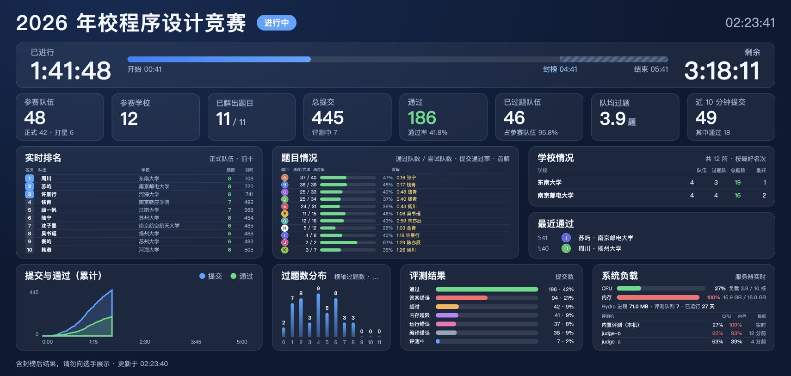

- 比赛名称、状态（未开始、进行中、已封榜、已结束）与当前时间；已进行与剩余时间，进度条下标出开始、封榜和结束时刻。
- 八项指标：参赛队伍（含正式与打星人数）、参赛学校、已解出题目、总提交（含评测中）、通过数与通过率、已过题队伍及占比、队均过题、近 10 分钟提交与其中的通过数。学校不计空白和“未填写学校”。
- 实时排名：正式队伍前十的名次、队伍、学校、题数与罚时（分钟）。排名规则与增强榜相同：题数多者在前，罚时少者在前，每次错误加 20 分钟，编译错误等不计罚时；题数与罚时都相同的队伍并列，按队名排列。
- 题目情况：每题的气球颜色、通过队数 / 尝试队数、提交通过率和首解（时间与队伍）。首解按增强榜设置决定是否计入打星选手。题目较多时文字自动缩小，所有题目都会显示。
- 学校情况：按最好名次排列，显示每校队伍数、过题队数、总过题数和最好名次。最近通过：最新的通过提交，标出首解与打星，新出现的一条会闪烁。
- 提交与通过的累计曲线（横轴为比赛全程）、过题数分布（各过题数的队伍数）、评测结果分布（通过、答案错误、超时、内存超限、运行错误、编译错误、评测中等）。
- 系统负载：Hydro 服务器的 CPU 使用率与平均负载、内存占用（Linux 下按可用内存计算，不把系统缓存算作占用）、当前 Hydro 进程内存、全站评测队列和服务器已运行时间，每次刷新实时采样；评测机的 CPU 与内存来自评测机上报给 Hydro 的状态，独立评测机约每 20 分钟上报一次，“数据”一栏显示上报于几分钟前。使用 Hydro 内置评测时，评测与服务器在同一台机器上，显示的就是服务器的实时数据。超过 70% 显示为橙色，超过 90% 为红色；放不下时优先显示内置评测和负载最高的评测机。多进程部署时，“Hydro 进程”为响应本次请求的那个进程。
- 按 F、点击页面或右下角按钮进入全屏，Esc 退出；鼠标静止 3 秒后隐藏指针与按钮。画面按 16:9 设计并随屏幕缩放，4:3 屏幕上指标排为两行，窄窗口中改为上下排列并可滚动。

数据规则：始终显示实时数据，封榜期间的排名、首解和最近通过也包含封榜后的结果，页脚有相应提示，请勿在选手能看到的地方展示。只统计比赛时间内的提交，打星选手计入总数但不参与排名。选手名为显示名，学校对管理员显示。登录失效时页脚提示重新登录。

## 系统管理

Hydro 的系统管理员（`PRIV_EDIT_SYSTEM`）可在控制面板（`/manage`）的侧边栏使用以下页面。

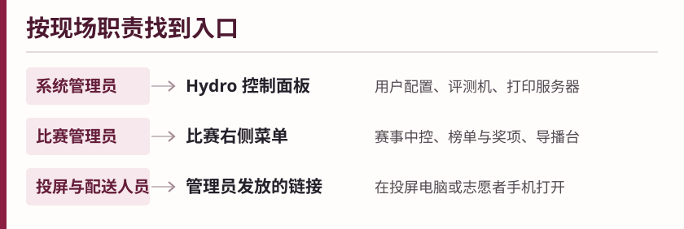

### 用户配置

位于“导入用户”下方（`/manage/xcpcio-users`），分“用户”“队伍”和“座位与 IP”三页，输入即搜索，支持分页。

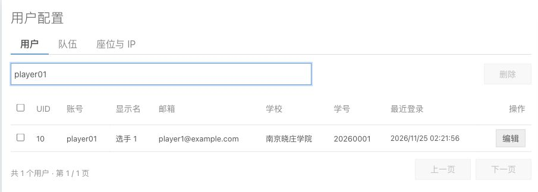

- 用户：可修改显示名（按当前域保存，与“导入用户”一致）、邮箱、密码、学校和学号；账号名与 UID 不可修改。修改密码后该用户已登录的会话会退出。修改其他系统管理员的密码或邮箱时，需要输入当前登录管理员的密码。系统内置账号和超级管理员不能在此修改。
- 队伍（Hydro 5.1 组队比赛的队伍）：可修改队名、队员和待接受的邀请，队员与受邀者填账号名或 UID；可勾选同步到该队已报名的比赛。Hydro 的队伍没有自己的密码，选手用各自账号登录，“重置全体队员密码”会把所有队员的登录密码改为同一个新密码。
- 删除与批量删除：勾选后点击“删除”（按钮显示所选数量），或在用户、队伍的编辑弹窗中点击“删除用户”“删除队伍”，都需要输入当前登录管理员的 Hydro 密码。删除用户会移除其账号、登录会话、域成员身份、用户组和队伍成员身份，可选同时删除其提交记录与比赛报名；超级管理员、系统管理员（需先在“用户权限”中撤权）和当前账号不能删除。删除队伍时队员账号保留，可选同时取消该队的比赛报名。删除无法恢复。

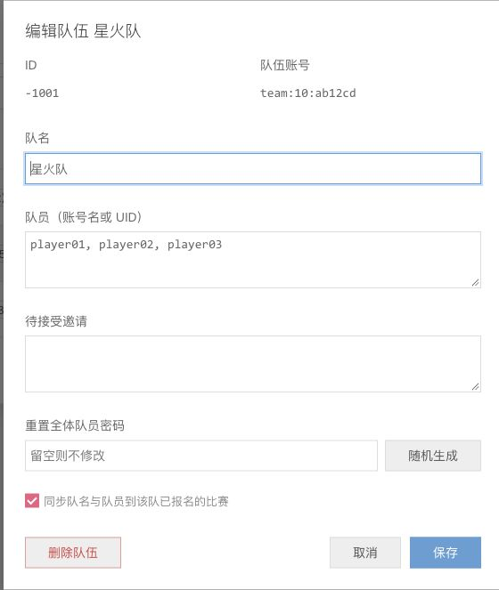

#### 座位与 IP

管理 onsite-toolkit 导入的座位（账号上的 `seat`）与 IP 登录（`iplogin` 集合，一个地址对应一个账号，从该地址打开 Hydro 即以此账号登录）。用于赛前核对和赛后清理：

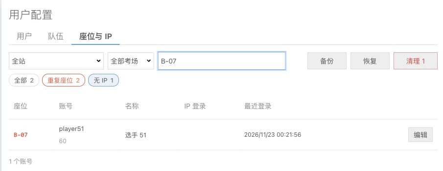

- 范围：“全站”列出所有有座位或 IP 登录的账号，以及账号已被删除的 IP 登录（“失效映射”）；选择一场比赛则列出它的全部参赛者（组队比赛含队伍与队员）。可再按考场筛选、按座位 / 账号 / 名称 / IP 搜索。
- 筛选：全部、重复座位、无座位、无 IP、失效映射，旁边是数量，没有的项不显示。重复座位指同一座位被不同账号占用（同队队员与其队伍共用座位不算），座位号显示为红色。最近登录 IP 不在 IP 登录绑定中时，该 IP 显示为橙色。
- 编辑：修改单个账号的座位和 IP 登录（每行一个地址）；地址已绑定到其他账号时会改绑到此账号，并提示原账号。队伍账号不能 IP 登录。
- 备份：把当前列表的座位与 IP 登录保存在插件中（`xcpcio.manage.seat.backups`，保留最近 50 份）并下载一份 JSON。
- 清理：清除当前列表中账号的座位和 IP 登录。勾选“退出登录”时，还会删除这些账号的登录会话，内置账号、超级管理员和当前账号除外。需要输入管理员密码，清理前自动备份。被清除的 IP 从下一次请求起无法自动登录。未勾选退出登录时保留已有会话。
- 恢复：从插件保存的备份或下载的文件恢复座位和 / 或 IP 登录，只恢复仍存在的账号；恢复前会备份将被覆盖的内容。需要输入管理员密码。
- 免登录链接（选择比赛后显示）：大屏、直播 overlay、气球台和画面采集设备的链接不需要 Hydro 登录。橙色表示比赛结束前签发、仍然有效的链接，灰色表示比赛结束后才更换过（没有人拿到），虚线表示未启用。“全部更换”为这些功能各生成新的链接，用旧链接打开的页面随即停止（大屏和气球台在下一次刷新时停止）；需要继续使用时到各自页面复制新链接。

建议的赛后顺序：在比赛范围内“备份”，然后“清理”座位、IP 登录与登录状态，再“全部更换”免登录链接。

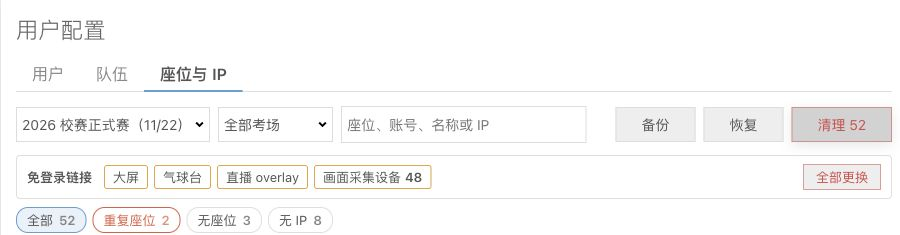

### 评测机控制

`/manage/xcpcio-judges`，每 5 秒刷新在线状态。

- 评测机健康：列出全部评测机，包括随 Hydro 运行的内置评测（hydrojudge 插件）、已连接的独立评测机和只在上报中出现、当前未连接的机器，显示状态、正在评测与并发、最近 5 分钟评测数、平均用时、最近 15 分钟系统错误，以及 CPU、内存和温度（内置评测为本机实时采样，独立评测机为其最近一次上报）。没有在线评测机、评测机断开、系统错误过多或 CPU、内存过高时在表格上方告警，规则与比赛的评测监控相同。

- 添加评测机：填写账号名后自动创建评测账号（评测权限）并生成 hydrojudge 的 `~/.hydro/judge.yaml`，自动复制到剪贴板。服务器地址取 Hydro 系统设置中的站点地址，未设置时用当前访问的地址。
- 复制配置：可多次复制，每次都会为该账号生成新密码，之前复制的配置随即失效；已连接的评测机继续工作，重启后需使用新配置。
- 删除与批量删除：需要输入管理员密码，在线的评测机立即断开，其手头任务退回队列由其他评测机评测。
- 负载均衡：Hydro 的评测队列由评测机主动领取。每台评测机可设置：
  - 暂停 / 恢复：暂停后保持连接、完成手头任务，但不再领取新任务；
  - 并发上限：同时评测的任务数，不超过评测机自身配置，性能强的机器设置更高的上限即可分得更多任务；
  - 只评测指定语言：把较慢的语言集中到指定机器；
  - 任务范围：全部、只评新提交（不接重测）或只评重测任务，避免批量重测拖慢比赛评测。
  设置保存后立即对所有已连接的评测机生效，多进程部署时其他进程在数秒内生效。从未设置过的评测机保持 Hydro 默认行为。内置评测（hydrojudge 插件随 Hydro 运行）不经过评测账号，不受这些设置影响。

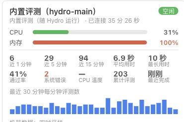

### 打印服务器管理

`/manage/xcpcio-printers`，位于“评测机控制”下方。新的打印请求、打印服务器领取和回报结果、打印服务器上线或打印机变化时页面立即更新（多进程部署下同样送达），另每 30 秒刷新一次以发现离线的打印服务器；正在操作列表或打开弹窗时，更新推迟到操作结束。打印服务器是运行打印客户端的电脑：它领取选手在比赛“打印”页提交的打印请求（比赛设置中需开启“允许打印”），在本机打印机上打印，并把本机的打印机同步到这里。

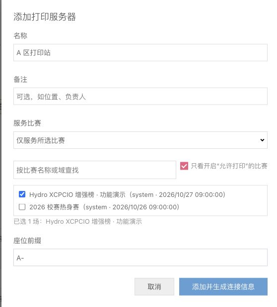

**连接一台打印电脑**

1. 在本页“添加打印服务器”，填写名称（如“打印室 A 区”），点击“添加并生成连接信息”，复制以 `hydro-print:` 开头的连接信息。连接信息包含访问密钥，只在生成时显示；忘记时点击“连接信息”重新生成，原来的连接随即失效。
2. 在打印电脑上下载对应系统的打印客户端（本页“打印客户端”中的链接，或插件 GitHub Release 中的 `hydro-print-client-*`）。客户端是单个程序文件，无需安装、没有其他依赖：
   - Windows：双击 `hydro-print-client-windows-amd64.exe`（ARM 电脑用 `arm64`）。未签名的程序首次运行时若出现 SmartScreen 提示，点击“更多信息 → 仍要运行”；
   - macOS：在终端执行 `chmod +x hydro-print-client-darwin-arm64 && xattr -d com.apple.quarantine hydro-print-client-darwin-arm64`（Intel 电脑用 `amd64`），然后 `./hydro-print-client-darwin-arm64`；
   - Linux：`chmod +x hydro-print-client-linux-amd64 && ./hydro-print-client-linux-amd64`，需要系统已安装 CUPS（提供 `lp`、`lpstat`）。
3. 按提示粘贴连接信息并回车。连接信息保存在程序旁的 `hydro-print-client.json`（该文件夹不可写时保存在用户配置目录），之后直接运行即可。也可用 `--connect <连接信息>` 指定，`--reset` 清除。
4. 连接成功后，这台电脑的打印机出现在本页对应的打印服务器下；点击“打印测试页”确认打印效果。

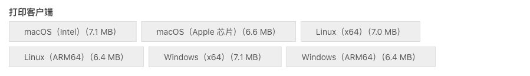

打印电脑需要能访问 Hydro 的地址（连接信息中的地址取自系统设置的站点地址，未设置时为生成时浏览器访问的地址）。自签名 HTTPS 证书可加 `--insecure`。

使用网络打印机时，先在打印电脑的系统设置中添加它，再运行客户端的 `--printers` 检查是否列出该队列。macOS 中文环境请使用 v1.6.1 或更新的客户端。

**打印方式**：Windows 直接调用系统打印接口（winspool / GDI），使用打印机自身的纸张，中文使用系统自带的微软雅黑；macOS、Linux 由客户端生成 PDF，交给系统的 CUPS（`lp`）打印，纸张默认 A4（`--paper Letter` 可改）。PDF 中代码使用标准等宽字体，中文使用 PDF 预定义的中文字体，由系统自动替换为已安装的中文字体，不需要额外的字体文件；Linux 需要安装中文字体（如 Noto CJK）。

**排版**：每份打印请求单独成一个打印任务，每页顶部重复一个页眉框，显示比赛名、队伍名（打星队伍注明）、右上角醒目的座位号，以及学校、队员、账号、文件名、语言、请求时间、编号和行数（每项可在“打印排版”中开关），页脚为队伍、座位和页码，方便分发。代码为黑白打印友好的高亮（关键字和预处理指令加粗，注释斜体灰色，字符串深灰），带行号，长行自动折行；可关闭高亮、行号，调整代码字号。

**座位号**：取自 Hydro 官方 onsite-toolkit 插件导入的队伍信息——它的快速导入（`onsiteImport`）把每支队伍 JSON 中的 `seat` 写到队伍账号上，打印时直接读取，不在本插件中另行配置。Hydro 5.1 的组队队伍本身没有座位时，使用第一位导入了座位的队员的座位。没有座位的队伍打印时不显示座位号；修改座位请重新用 onsite-toolkit 导入。

**分工与负载均衡**

- 服务比赛：添加打印服务器或在“设置”中选择“服务全部比赛”或“仅服务所选比赛”，可选一场或多场（可按名称或域查找，默认只列出开启了“允许打印”的比赛，未开启的会标注）。仅服务所选比赛时，这台电脑只打印这些比赛的请求；同时进行多场比赛时，可让各考场的电脑各自只打本场。服务全部比赛的电脑也会打印这些比赛的请求，若要某场只由指定电脑打印，请把其他电脑也设为仅服务各自的比赛。
- 座位范围：填写座位前缀（如 `A`、`B`，按 onsite-toolkit 导入的座位号开头匹配）后，这台电脑只打印这些座位的请求；不填的电脑打印其他打印服务器未认领的座位和没有座位的请求。各区域只有一台填了前缀的电脑时，它离线期间该区域的请求会等待，建议另留一台不填前缀的电脑兜底。所有在线的电脑都填了前缀时，没有座位号或座位不在任何范围内的请求由任意一台打印，不会一直等待。
- 没有任何在线打印服务器服务的比赛，其打印请求保持“待打印”，直到有打印服务器上线。
- 同一份请求只会被一台电脑领取。电脑领取后 5 分钟没有回报（关机、断网），请求自动退回队列。
- 一台电脑上的多台打印机按权重（1 至 10）轮流打印，例如权重 3 与 1 的两台按 3:1 分配；缺纸、卡纸、脱机或暂停的打印机自动跳过，打印出错的打印机休息 1 分钟。取消“参与打印”可把打印机移出轮换；PDF、XPS、传真等虚拟打印机默认不参与。设置在几秒内同步到打印电脑。
- 打印失败的请求退回队列，可能由其他电脑重试，失败 3 次后标记为失败；在“最近的打印请求”中可勾选已打印或失败的请求重新排队（正在打印的不能勾选，以免重复打印）。打印机出错后休息一分钟，期间这台电脑不再领取请求；领到但没有可用打印机的请求直接退回队列，不计失败次数。结果回报失败时客户端会在约一分钟内重试。
- 停用打印服务器后不再领取请求；删除需要输入管理员密码，它手中的请求退回队列。

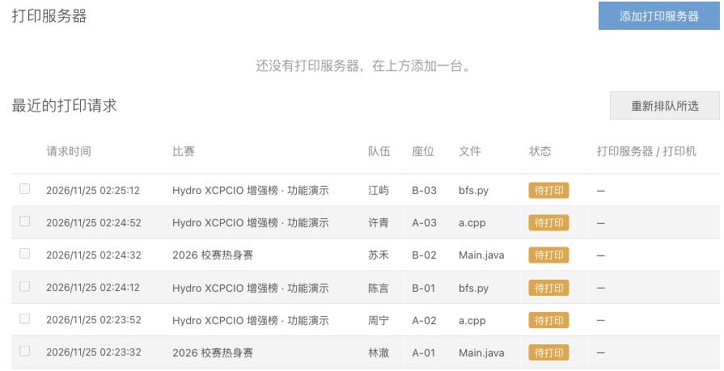

**小票机（气球小票）**

- 在打印机的“类型”中选择“小票机”后，这台打印机只打印气球配送的小票（见“气球配送”），不再参与代码打印；“已打印”一栏显示打印的小票张数，“测试小票”打印一张样例小票。
- 纸宽：58 mm 或 80 mm。输出方式：
  - **ESC/POS 指令**（默认）：服务器生成小票机的 ESC/POS 指令（中文为 GB18030/GBK 编码，绝大多数国产热敏小票机的默认设置），客户端原样发送给打印机：Windows 以 RAW 方式交给打印队列，macOS、Linux 用 `lp -o raw`。不经过驱动排版，打印快、可自动切纸。中文需要服务器的 Node.js 带完整 ICU（官方安装包默认如此），否则设置页会提示。
  - **系统驱动**：客户端按纸宽绘制小票，经打印机驱动打印（Windows 使用驱动的纸张；macOS、Linux 生成与小票等长的 PDF，`media=Custom.宽x长mm`），适合不支持 ESC/POS 的打印机。
- 自动切纸：打印后切纸（ESC/POS 模式发送切纸指令）。
- 小票机需要 1.14.0 或更新版本的打印客户端；旧客户端不会收到小票，它的小票机自动暂停，本页会提示更新。
- 试运行时可把“保存到文件夹”打印机设为小票机：每张小票存为 PDF，ESC/POS 模式另存 `.escpos` 原始指令。

**试运行**：客户端加 `--to-folder <文件夹>`（可配合 `--folder-printers 2`）会多出“保存到文件夹”打印机，把打印内容存为 PDF，不用纸即可检查流程与负载均衡；`--sample 样张.pdf` 只生成一张样张，`--print-sample <打印机名>` 在指定打印机上打印样张，`--printers` 列出本机打印机。

客户端源码位于 `print-client/`（Go，只用标准库），`pnpm build:print-client` 构建全部平台，安装包随附构建结果。

### 批量重测

`/manage/xcpcio-rejudge`。

- 范围：先填写域（默认当前域），再选择：
  - 按比赛：选择比赛，可勾选其中部分题目（不选为全部题目）；
  - 按题目：输入题号、题目 ID 或标题搜索并点选（可多选，回车选中第一条），重测这些题目在该域内的全部提交（含比赛内的提交）；
  - 整个域：重测该域的全部提交，开始前需要输入管理员密码。按比赛、按题目时没有选择比赛或题目会提示，不会变成整域重测。
- 评测结果：可多选，如只重测 TLE、MLE；不选为全部结果，已取消的提交始终不重测。“AC 不参与重测”默认勾选，已通过的提交保持原结果。
- 先“预览数量”查看按结果、按题目的统计，确认后开始重测。与 Hydro 题目页的“重测”相同：原结果清空后重新排队，优先级低于新提交，比赛中的提交按比赛设置显示结果，任务带有重测标记，可配合评测机控制的“任务范围”分流。一次最多 100000 条，按每批 2000 条加入评测队列。
- 重测记录：页面下方保留每次重测的时间、操作人、范围与筛选条件、提交数和进度，记录永久保存在 `xcpcio.manage.rejudge.jobs`。点击“查看变化”可看到结果如何变化，例如“AC → WA × 3”“WA → AC × 5”，以及每条提交重测前后的结果与得分（默认只看结果变化的提交，可切换为全部），提交编号可打开 Hydro 的评测记录；仍在评测的提交显示为“评测中”，页面每 5 秒更新。重测前的结果在清空前写入 `xcpcio.manage.rejudge.items`，重测后的结果在 Hydro 评测完成时记录；若期间 Hydro 重启错过了评测完成，打开记录时按提交的当前结果补全。同一提交被再次重测时，新结果记入最近的一次重测。

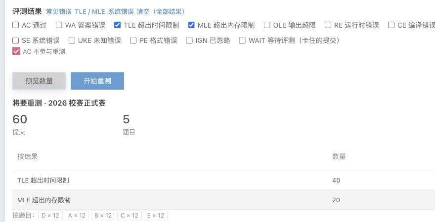

## 录制与反应视频

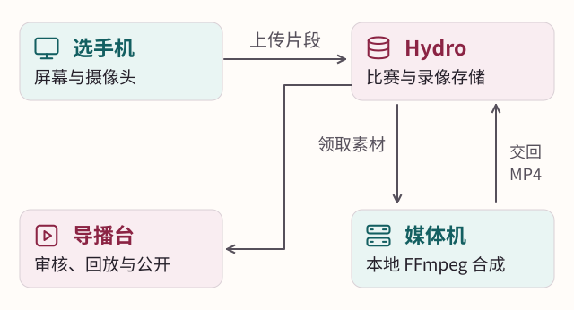

### 比赛前

1. 在比赛的「画面采集」启用设备，在「录制设置」选择提交片段、全程留档或两者。旧比赛升级后需要主动开启录像。摄像头声音沿用本场的麦克风设置，默认关闭。
2. 确认录制范围、评测前后保留的秒数和各路画质。填写上行带宽，再用容量估算和热身赛实测决定最终设置。留档摄像头默认关闭。
3. 在「测试」让一台设备试录并上传。掉帧、CPU 压力和吞吐量按浏览器能力显示。热身赛可让在线设备进行 3–15 分钟的全场压力测试，对照接收曲线、积压、失败率和场馆路由器数据。试录文件清理后仍可查看报告。
4. 在参赛须知注明录制内容、用途、联系人、实际保存期限和公开范围。可采用下列文字，将方括号替换为本场安排。

> 本场将录制参赛电脑的屏幕与[摄像头／麦克风，如启用]，供赛事工作人员回看。经赛事审核的反应视频将按[公开范围和时间]展示。原始录像保存至[日期]，有关录像的问题请联系[赛事联系人]。

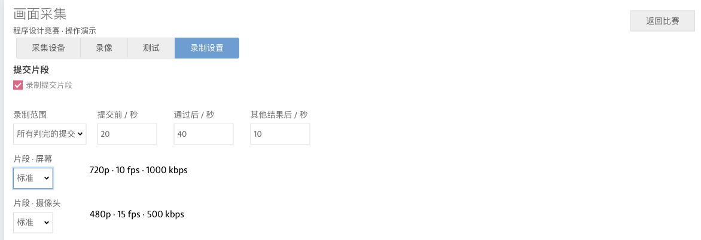

### 赛中与赛后

选手在采集窗口授权后，仅分享实时画面时显示「正在采集」，启用录像后显示「正在录制」和上传积压。提交片段默认从提交前 20 秒开始，持续至通过后 40 秒或其他判定后 10 秒，最长 120 秒。屏幕与摄像头各自按段缓存。断网恢复后继续上传，已超出保留窗口的时段记为缺段。「录像」按队伍、题目、结果和状态查看提交片段，留档按时间接续播放。清理前核对文件数和字节数，删除整场录像需输入比赛名称。

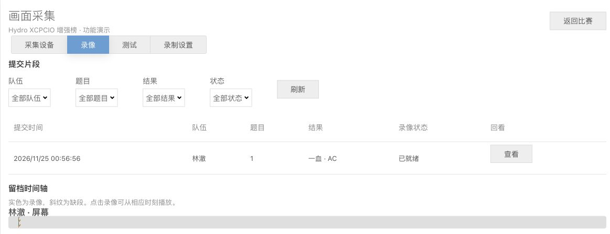

### 安装媒体机

媒体机从容器内主动访问本场 Hydro。准备一台已安装 Docker 与 Compose 的电脑。进入 **反应视频 → 媒体机**，首次点击「生成令牌」，再点击「复制接口地址」。同一比赛已有令牌时直接复制。


1. 在媒体机新建目录，将下列配置下载为 `compose.yaml`。Linux 或 macOS 可直接执行命令。

   ```sh
   mkdir -p hydro-reactions/out
   cd hydro-reactions
   curl -fL -o compose.yaml https://albert-li-sz.github.io/Hydro-Contest-Better/media-worker.compose.yaml
   ```

2. 在同一目录新建 `.env`，把下一行等号后的示例完整替换为本场接口地址。该文件仅供媒体机操作员保管。

   ```dotenv
   HYDRO_REACTIONS_API=https://contest.example/d/system/contest/CONTEST_ID/reactions-api/TOKEN
   ```

3. 执行配置校验、拉取和启动。配置默认使用 CPU 与固定版本公共镜像 `ghcr.io/albert-li-sz/reactions-generator-hydro:1.21.0`。输出保存在本机 `./out`。

   ```sh
   docker compose config --quiet
   docker compose pull
   docker compose up -d
   docker compose ps
   ```

4. 回到「反应视频 → 媒体机」，在「媒体机心跳」点击「刷新」，检查版本、在线状态和默认分区 `0/1`。管理页每台机器的心跳约每 15 秒更新。若没有心跳，可运行 `docker compose logs --tail=100 reactions` 检查网络和接口地址。

5. 用已开启「录制提交片段」的机位，在比赛时间内完成一次提交。等判题和后段上传后，在「画面采集 → 录像」查看片段，再在「反应视频 → 视频」预览「已完成」的成品。


Windows 可在 Docker Desktop 中运行同一 Compose 配置。赛场无法访问 GHCR 时，可在联网机器下载对应架构的镜像归档和 SHA-256 清单，复制到媒体机后校验并执行 `docker load`。[离线导入步骤](https://albert-li-sz.github.io/Hydro-Contest-Better/media-worker.html#offline)

多机部署、GPU 与 Apple VideoToolbox、本地源码方式、公开策略和故障处理见[媒体机图文教程](https://albert-li-sz.github.io/Hydro-Contest-Better/media-worker.html)。

### 版式与公开播放

在「版式」选择横屏、竖屏或自定义尺寸，调整摄像头、屏幕、卡片、文字和图片。每个版式可选择适用一血、通过或其他结果。一条提交可生成多个成品。通过「视频」检查、下载、撤下、恢复或重渲染成品。通过「公开设置」选择范围、时机、版式、学校和下载选项。公开默认关闭，启用后的默认时机为解除封榜后。赛中隐藏题号、封榜时段、直播屏幕限制和撤下状态都影响观众可看到的内容。选择隐藏学校时，系统会排除已经把学校字段或学校 Logo 合成到画面里的视频。自定义背景图、文字、上传图片和实拍画面的内容需由工作人员在公开前检查。

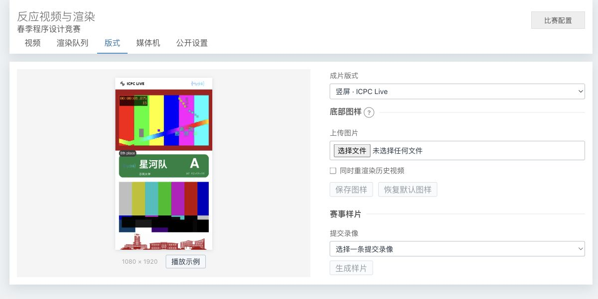

导播台在「精选提交」或「队伍画面」中展开「提交回放」，可预看原始片段和成品。公开 OBS 精选提交使用可公开的反应视频。「大屏 → 反应视频轮播」可选择一血或所有通过、分榜和播放间隔。版式默认跟随公开页，也可另选横屏等版式；每次播放仍核对撤下、封榜、屏幕和学校公开规则。

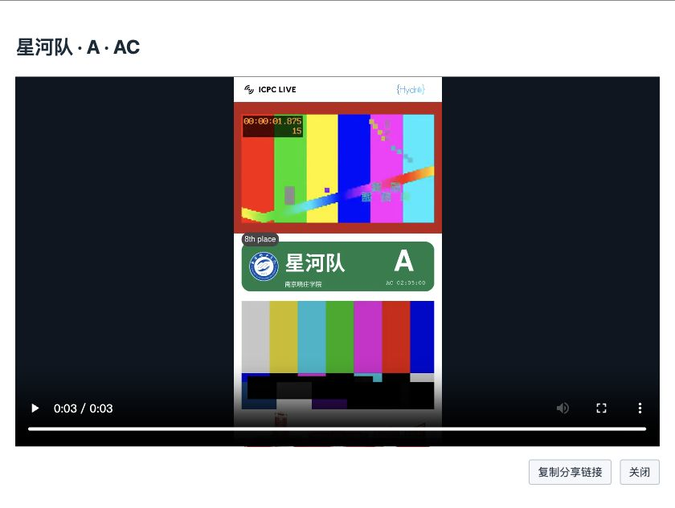

## 直播

直播移植自 [ICPC Live v3.5.1](https://github.com/icpc/live-v3)（MIT）。原版是独立的 Java 服务，这里把后端改写为 Node.js，直接运行在 Hydro 进程中，读取 Hydro 的比赛数据，不需要另装 Java 或配置 CDS 数据源。前端（OBS 画面与导播台）沿用 ICPC Live 原版界面。

比赛所有者和有“编辑比赛”权限的管理员可在比赛侧边栏的“直播”进入设置页（`/contest/<比赛ID>/live`），页面上有两个入口：

- **导播台**（`/contest/<比赛ID>/live/admin`）：ICPC Live 的管理界面，需要 Hydro 登录。界面默认中文，右上角可切换为 English（只影响当前浏览器）。可在 Controls（控制台）中显示或隐藏榜单、评测队列、题目统计、滚动字幕、全屏时钟和赛况总览；Titles 中添加标题字幕（下三分之一条）、文字公告和图片；TeamView 中显示单队、两队对比或四分屏的队伍做题进度与时间轴；Scoreboard 中切换分榜和滚动方向；Ticker 中编排滚动字幕（文字、时钟、榜单片段、图片）；Analytics 中查看自动生成的中文解说，一键推送为字幕或公告；Spotlight 中查看系统推荐的关注队伍；Media 中上传图片与 SVG 字幕模板。多名导播可同时打开，任何一处的操作都会同步到其他导播台和画面。
- **直播画面**（`/contest/<比赛ID>/live-overlay/<令牌>`）：在 OBS 中添加“浏览器”来源，宽 1920、高 1080，链接后加 `?noStatus` 隐藏状态条，在“自定义 CSS”中填入 `body { background-color: rgba(0, 0, 0, 0); margin: 0px auto; overflow: hidden; }` 使背景透明。链接自带访问凭证，无需登录，可在设置页作废重建，作废后旧链接立即失效，已打开的 OBS 画面也会立即断开（多进程部署时同样如此），需要在 OBS 中换成新链接。导播台里的画面预览走 Hydro 登录，不受作废影响。

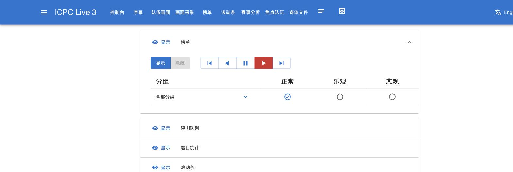

数据规则：

- 与公开榜一致：比赛开始前直播画面只显示比赛时钟和题目，不显示队伍（导播台仍能看到队伍，可提前设置队伍画面，比赛开始后自动显示）；封榜后的提交显示为封榜，直至解封。可见提交按 Hydro 的实际判题显示 WA、TLE、MLE、OLE、RE、CE 等结果，同一提交重测后更新；选手名显示显示名，是否显示学校跟随“向所有观众显示学校”。
- 排名、奖牌和一血与增强榜、滚榜、大屏使用同一套规则：罚时按秒累加，每次错误加 20 分钟，编译错误、格式错误和取消的提交不计罚时；题数和罚时都相同的队伍并列，并列队伍按队名排列。打星选手显示为 `*`，不参与排名和奖牌。
- 奖牌（金银铜）和一血使用主榜的奖项设置：开启“同分同奖”时并列队伍得到同一奖牌，否则按名次顺序发放；只有通过至少一题的正式队伍获奖。一血为各题最早通过的提交，同一时刻通过的都算，打星选手按设置决定是否计入。分榜对应 ICPC Live 的分组，可在 Scoreboard 中选择只显示某个分榜；与增强榜的分榜视图一样，这时显示的是分榜内的名次和该分榜自己的奖牌设置。
- 乐观榜和悲观榜分别把待定提交视为通过和错误，用于封榜后的悬念展示。
- 赛况总览是给观众看的整体情况，参照“赛况总览”页面：比赛时钟与进度、参赛队伍和学校数、提交与通过数、通过率、已过题队伍，正式队伍排名前列，各题通过队数、通过率与一血，学校情况，最近通过，累计提交与通过曲线、过题数分布和评测结果。它在导播台 Controls 的“赛况总览”中显示或隐藏，可设置画面语言（中文或 English）、标题、排名显示队数，以及排名、题目、学校、最近通过和图表各部分是否显示；画面位于榜单的位置，右侧的评测队列仍可同时显示。数据与公开榜一致：封榜后只统计封榜前的结果，并显示封榜后的提交数；赛中即可查看已公开提交的具体判题分布；比赛开始前只显示倒计时。与管理员的“赛况总览”页面不同，这里不显示系统负载。
- 导播台的三个直播组件默认关闭，可分别上屏。**首解快报**自动播报新首解的题号、队名和用时，同秒并列一并展示，重测后更正或撤回。首解快报和单题战况跟随导播榜单选中的主榜或分榜。首解与打星资格取自该榜的奖项设置，切换分榜时从当前结果开始监听。**奖牌线追踪**可选主榜或分榜，显示所选奖牌线内外的队伍、解题数和罚时差。**单题战况**按题目显示尝试队数、通过队数、结果分布和最近四次提交。三个组件共用公开画面与封榜规则。
- **统计**保留原版图表的队伍数，图例另列每种判题的提交次数。导播在解说列表中选中某次提交后，所有进程上的公开队列同步显示其机位画面，到期或手动撤下时一并消失。
- 首解快报使用原版队列的标题、题目色和首解闪光，奖牌线使用原版榜单的名次行与奖牌色，单题战况使用原版统计标题与判题块。画面沿用 ICPC Live 的字体、颜色、位置配置及转场。与队伍机位组合时，下方两个组件会给队伍时间线留出空间。
- 自动解说使用中文模板（提交、通过、未通过、一血），其中的名次和通过题数为该提交刚完成时的情况；Hydro 重启后按比赛历史重新生成的解说也按当时的情况计算。

说明与限制：

- 画面状态（显示中的组件、字幕、标题、图片）保存在 MongoDB，Hydro 重启后自动恢复；评测队列和解说列表在重启后按比赛历史重新生成。
- 后端在有画面或导播台打开时读取比赛数据：比赛进行中每 2 秒一次，赛前和赛后每 5 秒一次；无人使用 30 分钟后释放内存。
- 多进程（PM2 集群）部署时，每个进程都有一份直播后端；导播台的操作保存后通过 Hydro 的进程间广播通知其他进程，各进程的画面和连在各进程上的导播台保持一致。每个控件和每条字幕、图片独立保存，并发修改不同项会合并；同一项以数据库最后保存的操作为准。新内容使用 UUID，旧数字编号继续有效。重新上传的字幕模板、Spotlight 加分与解说的“已推送”标记也会同步。
- 画面上的比赛时钟按 Hydro 服务器时间显示，打开时及之后每分钟校准一次，OBS 电脑的系统时间不准也不影响。
- 导播被撤销比赛管理权限后，已打开的导播台连接在一分钟内断开。
- 插件配置中的“启用直播模块”关闭后，直播的页面、接口和侧边栏入口都不再提供，已保存的直播设置保留。
- Hydro 中没有屏幕录像、按键记录和评测时间数据，依赖这些数据的功能（如队伍定位 Locator 的摄像机场景）缺少对应素材。队伍的摄像头和屏幕来自“画面采集”（见下节），没有采集设备的队伍在 TeamView 和 Featured run 中没有视频画面，Featured run 会明确提示该队伍缺少所选视频画面。
- ICPC Live 的 settings.json、advanced.json 和自定义字段由 Hydro 比赛数据取代，导播台的 Configuration 中只保留 Contest Info（只读）和 Visual config（画面颜色、标题文字等，保存后刷新 OBS 画面生效）。画面配置通过 JSON 对象提交，上限为 200 KB（200000 字节，按 UTF-8 计算），超限时显示明确提示。后端地址由 Hydro 决定，Visual config 中不能设置以 `BASE_URL` 开头的项。
- 图片（Picture）的地址可填写完整网址、站内路径，或直接填写“媒体文件”中已上传（或内置）的文件名，保存后自动换成该文件的地址。新建的字幕（Title）和图片先保存为空，选好 SVG 模板或填写地址后才能显示，未选时导播台会提示。
- 上传的媒体文件单个不超过 12 MB，支持图片、视频、SVG 和 JSON；文件名保留中文、字母和数字，其他字符替换为下划线，同名文件会覆盖；SVG 字幕模板中的 `{name}` 等占位符由标题设置中的数据替换，`teamId` 可引用队伍名与学校（`{team.name}`、`{org.displayName}`）。

### 画面采集（选手屏幕与摄像头）

比赛侧边栏的“画面采集”（与“大屏”“直播”并列，`/contest/<比赛ID>/live/capture`）由 Hydro 统一管理选手机的屏幕和摄像头，需要比赛管理权限。不需要另外部署中继服务器：Hydro 只转交建立 WebRTC 连接所需的少量消息，视频在选手机和观看端（OBS 直播画面、导播台预览、管理页预览）之间点对点传输，不经过 Hydro 服务器。

**访问地址**：选手须使用浏览器信任的 HTTPS 地址访问比赛和采集页。反向代理需要转发 WebSocket，证书须匹配访问的域名或 IP，并受选手机信任。用明文 HTTP 内网 IP 打开页面时，浏览器禁用屏幕共享和摄像头接口。配置好 HTTPS 后，从 HTTPS 管理页重新复制采集链接。

画面采集有两级开关：插件配置中的“启用直播的画面采集”（默认开启，关闭后画面采集的页面、接口和设置页入口都不再提供），以及每场比赛管理页顶部的“启用画面采集”（**默认不启用**）。比赛未启用时可以先添加设备、分发链接，选手机打开采集链接后会等待，启用后半分钟内自动连接；停用后所有采集页立即断开，导播台和直播画面中不再有队伍画面，设备和链接保留。

选手机的开启方式：选手进入比赛后弹窗开启，无需启动参数。启用本场画面采集并勾选“选手进入比赛时提示开启”（默认勾选）后，参赛选手用 Chrome 或 Edge 登录并打开比赛的任意页面，会弹出提示。点击“开启画面采集”打开一个采集窗口，在窗口中点击“开始采集”，在浏览器的选择框中选择“整个屏幕”并点击“分享”，摄像头权限选择“允许”。选择窗口或标签页会被拒绝并提示重新选择整个屏幕。比赛页面右下角显示采集状态，换页不影响采集。每支队伍自动对应一台设备：已有覆盖该队座位或手动绑定的设备时使用它，否则自动创建。比赛管理员（所有者和有编辑比赛权限的用户）不会收到提示，比赛结束后也不再提示。浏览器规定屏幕共享必须由用户点击并选择，因此这一步不能完全省去。

管理页也可以“按座位添加”设备，用“复制链接”或“导出链接”（CSV）拿到每个座位的采集链接，选手机直接打开链接的效果与弹窗相同，同样需要选手点击“开始采集”并选择整个屏幕。

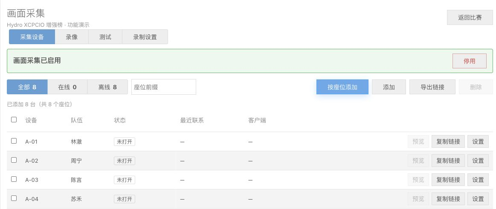

设备列表上方的“全部 / 在线 / 离线”按钮同时显示数量并用于筛选；“座位前缀”输入框按座位号开头筛选（如 `A`、`B1-`，不区分大小写），输入时会提示已有的区域。勾选、删除、导出链接和“全部预览”都只作用于当前筛选出的设备，筛选条件在本浏览器中保留。采集设置位于页面底部，修改后自动保存；“重新生成链接”在设备的“设置”中。

设备显示“在线”后，在管理页点“预览”确认画面。选手机连上、断开或开始采集时，管理页和导播台“画面采集”页立即更新，无需刷新；导播台该页也可按座位前缀筛选。

导播台中调用采集画面：

- 导播台新增“画面采集”页，列出所有采集设备及其队伍，默认选择屏幕（可切换为摄像头）。可预览任意设备，一键“上屏”（单队全屏画面）或放到四分屏的某一格，“撤下队伍画面”收回。
- 导播台“队伍画面”中的屏幕（screen）和摄像头（camera），以及评测队列的放大播放，也直接使用这些画面，默认选择屏幕。队伍列表每 10 秒刷新一次，后连上的选手机无需刷新导播台即可选用。
- “只采集屏幕”：取消设置中的“采集摄像头”后，选手机只共享屏幕，不再请求摄像头权限，导播台中也只有屏幕。

防止中途关闭：

- 采集窗口在录制时，窗口内醒目提示“正在录制屏幕和摄像头”，标签页标题显示“● 正在录制 · 请勿关闭”。
- 关闭采集窗口、刷新或退出浏览器时，浏览器会先弹出确认（确认框的文字由浏览器决定，不能自定义）。
- 采集窗口仍被关闭或停止共享时，选手的比赛页面立即弹出“画面采集已中断”并要求重新开启，右下角状态变为“已中断”；管理页显示该设备离线或不再列出屏幕。

规则与限制：

- 摄像头随时可用（未取消“采集摄像头”时）。屏幕默认在比赛进行中即可用于直播画面，导播台默认调用屏幕；屏幕会显示正在写的代码，选手能看到直播时请取消“比赛中直播可用屏幕”。取消后，屏幕在比赛结束后才提供；比赛设了封榜时，要等到解除封榜，以免先于滚榜透露结果。比赛管理员在管理页和导播台的预览不受此限制。这一规则在 Hydro 服务器端执行，直播画面链接无法绕过。
- 采集链接带有设备密钥，无需登录，可在管理页查看、复制或重新生成。重新生成、删除设备或关闭画面采集后，对应的采集页立即断开；作废直播画面链接后，旧链接上的画面也立即断开。同一设备的链接在第二个页面打开时，第一个页面断开。
- 选手机只在有人观看时才上传画面，同时观看的路数越多，上传带宽越大；每个观看页面最多同时观看 16 个画面。屏幕默认 720p、15 帧，可改为 1080p 或其他帧率；摄像头默认 480p，可选择同时采集声音。修改后正在采集的选手机立即使用新设置；取消“比赛中直播可用屏幕”时，直播画面中正在播放的屏幕立即停止。
- 采集要求比赛使用 HTTPS 地址：浏览器只允许 HTTPS（或本机 localhost）页面共享屏幕和摄像头。通过 HTTP 访问时，比赛页面和采集窗口会提示改用 HTTPS 地址。
- 网络：OBS 电脑（及导播、管理员的电脑）需要能和选手机直接通信，UDP 不能被拦截。Hydro 内置一个 STUN 服务（插件配置“画面采集内置 STUN 服务的 UDP 端口”，默认 3478，0 为关闭；只回应 Binding 请求，回应不大于请求），页面自动在访问 Hydro 的主机名上使用它，让双方拿到彼此的真实地址，只采集屏幕、没有摄像头权限时也能直接连接；请在防火墙中放行该 UDP 端口。多进程部署时由其中一个进程提供。也可以在设置中另填 STUN 服务器；选手网和直播网完全隔离时，需要在设置中填写一台两边都能访问的 TURN 服务器（如 coturn）。
- 采集页需要保持打开；关闭或停止共享后，已在播放的画面停止，重新开启后自动恢复。浏览器会显示“正在共享屏幕”的提示条。
- 多进程（PM2 集群）部署时，选手机和观看端可能连在不同进程上，连接消息通过 Hydro 的进程间广播转交。
- 浏览器启动参数的效果因系统和浏览器版本而异，赛前请在实际的比赛镜像和网络中逐项实测。

### 直播来源与许可

ICPC Live 的 MIT 许可证见 `licenses/ICPC-Live-MIT.txt`。前端由 `scripts/build-live.mjs` 从固定提交 `200c82f81ffdea91ffec9cc17b314ffc72436a0f` 打上 `live/frontend.patch` 后构建，修改内容为：后端地址改为从 Hydro 页面读取、画面时钟改用 Hydro 服务器时间、移除依赖 Java 服务配置文件的页面、用本地文本编辑器替换从 CDN 加载的 Monaco 编辑器，新增赛况总览、首解快报、奖牌线追踪和单题战况，支持导播台中英双语与 Hydro 采集的队伍画面。排名、奖牌与一血改用本插件统一的规则，不再使用 ICPC Live 按最后通过时间区分并列和按奖项链整组发放的做法。后端移植位置见 `live/UPSTREAM.json`。

